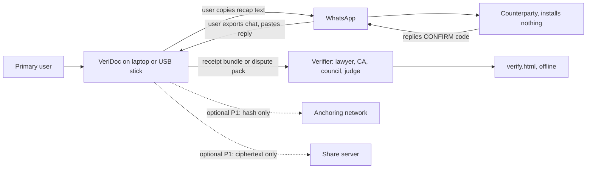
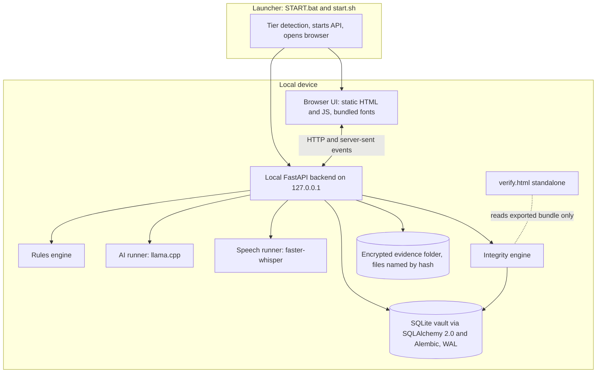
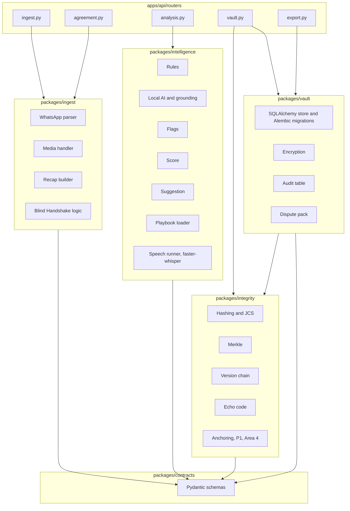
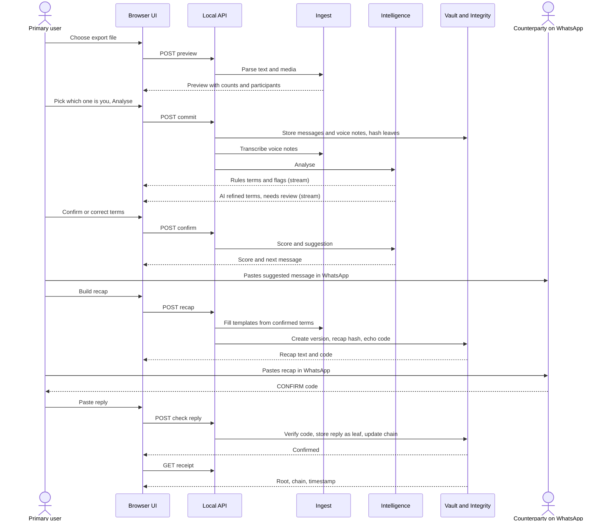
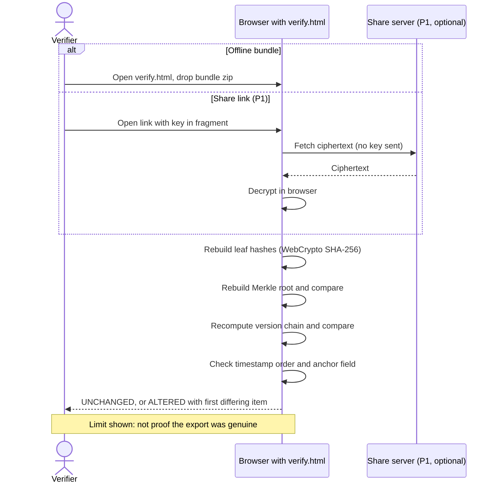
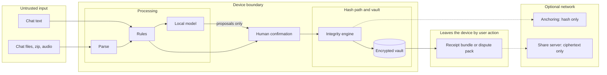
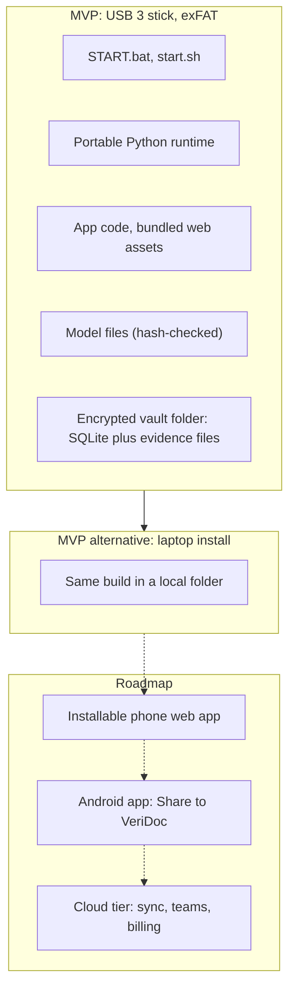

# Architecture

This document describes how VeriDoc is built: system context, containers, components, key sequences, trust boundaries, deployment, technology, folders, API, errors, configuration, logging and the path to production. The code does not exist yet; this is the design the team builds to.

Last updated: 2026-10-25
Status: Draft v1

Related: [PRD](PRD.md), [INTEGRITY_SPEC](INTEGRITY_SPEC.md), [AI_SPEC](AI_SPEC.md), [DATA_MODEL](DATA_MODEL.md), [DECISIONS](DECISIONS.md), [THREAT_MODEL](THREAT_MODEL.md).

## 1. System context

The primary user runs VeriDoc on a laptop. The counterparty uses only WhatsApp. A verifier opens the verify page. Anchoring and share link are optional and off by default.



VeriDoc never connects to WhatsApp. All exchange with WhatsApp is by the user copying text and exporting chats.

## 2. Container view



| Container | Responsibility | Owner |
|---|---|---|
| Launcher | Detect hardware tier, start the API, open the browser | Area 1 (tier thresholds: Area 2) |
| Browser UI | Screens S1 to S12, built against mock data matching contracts | Area 4 |
| Local API | Thin routes, SSE streams, no business logic. `main.py` is Area 3; each router belongs to its area | Areas 1 to 3 |
| Rules engine | Deterministic parsers, flags, score, suggestion text | Area 2 |
| AI runner | Local model refinement with schema-constrained output | Area 2 |
| Speech runner | Voice-note transcription at import, behind an interface that `packages/ingest` calls | Area 2 |
| Integrity engine | Hashing, Merkle, version chain, echo code | Area 3 |
| Anchoring (P1) | Polygon contract and client, only hashes leave the device | Area 4 |
| Vault | SQLite through SQLAlchemy 2.0, Alembic migrations, encryption, audit table, encrypted evidence folder, dispute pack | Area 3 |
| Verify page | Standalone offline check; must pass Area 3's test vectors | Area 4 |

## 3. Component view of the backend



Dependency rules:
1. Packages depend on `packages/contracts` and on nothing else shared.
2. `packages/intelligence` must not import `packages/vault` or the hashing functions of `packages/integrity` (the AI cannot reach the hash path).
3. Only `packages/vault` writes to the database.
4. Routers call packages and contain no logic.
5. Network calls exist only in the anchoring and share modules.

## 4. Sequence: import to receipt



## 5. Sequence: verification



## 6. Data flow and trust boundaries



Rule: the arrow from the model goes only to human confirmation. Nothing from the model reaches the hash path.

## 7. Deployment view



Windows, macOS and Linux runtimes ship side by side on the stick. The stick is a delivery vehicle and demo proof; the product does not depend on it.

## 8. Technology

| Layer | Choice | Reason |
|---|---|---|
| Backend | Python 3.11+, FastAPI, Pydantic v2 | One language for rules, AI and integrity; typed I/O |
| Live updates | Server-sent events | One-way stream is enough; simple |
| Rules | `re`, `dateparser`, `rapidfuzz` plus custom parsers | Fast, deterministic, explainable |
| Local AI | llama.cpp via `llama-cpp-python`, small open instruction models, JSON-schema output | CPU-friendly, offline, valid structured output |
| Speech | faster-whisper (small; base on low tiers) | Good Hindi and English accuracy for size; Python |
| Storage | SQLite WAL | Single file, crash-safe, no server |
| ORM and migrations | SQLAlchemy 2.0, Alembic | Typed models; versioned schema; insert-only triggers shipped as raw SQL in a migration (ADR-021) |
| Evidence files | Encrypted local folder, files named by hash | No object store needed on one device; content-addressed |
| Object store (roadmap) | MinIO or any S3-compatible store | Only for the cloud tier's share bundles; not in the MVP |
| Encryption | AES-GCM, Argon2id | Standard, reviewed primitives |
| Integrity | SHA-256, salted Merkle, domain separation, RFC 8785 JCS | Offline verify with WebCrypto; cross-language |
| Anchoring (P1) | Polygon, Amoy testnet in the demo | Cheap independent timestamp; hash only |
| Frontend | Static HTML and JavaScript, no CDN | Works offline; no build step needed at demo time |
| Verify page | Vanilla JavaScript, WebCrypto | Auditable single file |
| PDF | fpdf2 with uharfbuzz, or browser rendering (decision TBD) | Correct Indic shaping |
| Packaging | Portable runtimes; START.bat and start.sh; exFAT | No installer or admin rights |
| Quality | pytest, ruff, mypy, gitleaks, pip-audit, pre-commit | Catch errors and secrets early |

## 9. Folder structure and owners

This matches the repository skeleton and CODEOWNERS exactly.

```
Veridoc/
├── apps/
│   ├── api/                    FastAPI app, thin layer of routes only
│   │   ├── main.py             loads routers automatically; hotspot, Area 3 only
│   │   ├── settings.py         the one settings module (pydantic-settings); Area 3
│   │   └── routers/
│   │       ├── ingest.py       Area 1: import and voice
│   │       ├── agreement.py    Area 1: recap and Blind Handshake
│   │       ├── analysis.py     Area 2
│   │       ├── vault.py        Area 3
│   │       └── export.py       Area 3
│   ├── web/                    Area 4
│   │   ├── components/         shared UI pieces, Area 4 only
│   │   ├── screens/            one folder per screen: s1-deals ... s12-whatsapp
│   │   └── assets/             bundled CSS, JS and Indic fonts, no CDN
│   │       ├── design-tokens.css   the one tokens file: colours, spacing, type, radii, light and dark
│   │       ├── fonts.css           @font-face for the bundled fonts
│   │       └── fonts/              Noto Sans, Devanagari and Kannada (woff2, SIL OFL)
│   └── verify/                 standalone verify.html, Area 4
├── packages/
│   ├── contracts/              shared Pydantic schemas, the ONLY shared code
│   ├── ingest/                 Area 1: WhatsApp parser, media, voice import wiring, recap builder, Blind Handshake logic
│   ├── intelligence/           Area 2: rules, local AI, flags, score, suggestion
│   │   └── speech/             Area 2: faster-whisper speech runner (interface called by ingest)
│   ├── integrity/              Area 3: hashing, Merkle, version chain, echo code
│   │   └── anchoring/          Area 4: Polygon anchoring (P1)
│   └── vault/                  Area 3: SQLite, encryption, audit table, dispute pack
├── playbooks/                  Area 2: supply_order.yaml, freelance.yaml
│   └── templates/              Area 1: recap and suggestion templates (en/, hi/)
├── eval/                       Area 2: chats/, labels/, runner/, reports/ (git-ignored)
├── test-vectors/integrity/     Area 3: hashes that Python and JS must both match
├── packaging/                  Area 1: START.bat, start.sh, portable runtimes, tier detection
│   └── tests/                  Area 1: end-to-end tests of the built app
├── models/manifest.json        model names and SHA-256 only, never weights
├── scripts/                    trust report and dev helpers
├── docs/                       each document has an owner listed in TEAM_GUIDE
├── changes/                    changelog fragments, one file per pull request
├── .github/                    CODEOWNERS, pull_request_template.md, ISSUE_TEMPLATE/
│   └── workflows/              Area 3: CI
├── pyproject.toml + uv.lock    Area 3 (Hardik) only
├── CHANGELOG.md               combined from changes/ at phase end by the release lead
├── .gitattributes              line endings (LF) and binary file rules
├── .gitignore                  Python, Node, OS, secrets, weights, reports, real chats
├── .env.example                names of environment variables, no values
├── .pre-commit-config.yaml     ruff (lint, format) and gitleaks on every commit
├── .editorconfig               indentation and final newline rules
├── CLAUDE.md
├── AGENTS.md
└── README.md
```

Each package has its own `tests/` folder inside it. There is no shared top-level tests folder. Alembic migrations live inside `packages/vault/migrations/` (Area 3), so they add no new top-level folder. Each package keeps its fixtures in its own `fixtures/` folder (created by the owning area when needed). `apps/api/main.py` loads every module in `apps/api/routers/` automatically (ADR-022), so adding a route never touches `main.py`. The design tokens live in one file, `apps/web/assets/design-tokens.css` (Area 4, Hardik).

| Area | Owns | Role |
|---|---|---|
| 1. Ingest, Agreement and Release | `packages/ingest`, `apps/api/routers/ingest.py`, `apps/api/routers/agreement.py`, `playbooks/templates/`, `packaging/`, sample chats and demo voice notes | Ingest, agreement and release lead | Hardik (@HARDIKSINGH150206) |
| 2. AI and ML | `packages/intelligence`, `playbooks/` (except `playbooks/templates/`), `eval/`, `apps/api/routers/analysis.py` | AI and ML lead | Abhishek (@absksync) |
| 3. Backend, Integrity and Vault | `apps/api/main.py`, `packages/contracts` (steward: Hardik; changes need Hardik and Abhishek), `packages/integrity` (except `packages/integrity/anchoring/`), `packages/vault`, `test-vectors/`, `apps/api/routers/vault.py`, `apps/api/routers/export.py`, `.github/workflows/`, `pyproject.toml`, `uv.lock` | Backend and integrity lead | Hardik (@HARDIKSINGH150206) |
| 4. Frontend and Blockchain | `apps/web`, `apps/verify`, `packages/integrity/anchoring/` | Frontend and blockchain lead; project release lead | Hardik (@HARDIKSINGH150206) |

Shared, changed only by small reviewed pull requests: `packages/contracts` (steward: Hardik; every change needs approval from Hardik and Abhishek), `docs/`, `.github/` (except `.github/workflows/`, Area 3). Dependency files (`pyproject.toml`, `uv.lock`) are owned by Area 3 (Jhashank). Release lead: Hardik. The word "Release" in Area 1's name means building, packaging and benchmarking the demo build; merging `dev` into `main` and tagging is the project release lead's job (Hardik).

## 10. API overview

All routes are under `/api`, bind to 127.0.0.1, require the session token header once the vault is unlocked, and return JSON using contract models. Paths are indicative; the contracts package is the source of truth.

| Router | Method and path | Request | Response |
|---|---|---|---|
| vault | `POST /vault/setup` | passphrase | recovery key (once) |
| vault | `POST /vault/unlock` | passphrase or recovery key | session token |
| vault | `POST /vault/lock` | none | ok |
| ingest | `GET /ingest/samples` | none | sample list |
| ingest | `POST /ingest/preview` | file or pasted text | counts, participants, date range, warnings |
| ingest | `POST /ingest/commit` | preview id, which-one-is-you, parties, deal type, date order | deal id |
| ingest | `POST /deals/{id}/messages` | simulator message | message |
| ingest | `GET /deals/{id}/voice/{vid}/audio?start=&end=` | none | audio clip for play-the-moment |
| vault | `GET /deals` | filter | deal summaries |
| analysis | `GET /deals/{id}/analysis/stream` | none | SSE: terms, flags, score, suggestion |
| analysis | `POST /deals/{id}/terms/{key}/confirm` | value | term |
| analysis | `POST /deals/{id}/terms/{key}/correct` | value | term, audit event |
| analysis | `POST /deals/{id}/terms/{key}/reject` | none | term |
| analysis | `GET /deals/{id}/suggestion?tone=` | none | suggestion |
| agreement | `POST /deals/{id}/handshake/start` | none | questions |
| agreement | `POST /deals/{id}/handshake/answers` | party, answers | seal record (refused until the first set is sealed) |
| agreement | `POST /deals/{id}/handshake/reveal` | none | side-by-side result |
| agreement | `POST /deals/{id}/recap` | language | recap text, lines, code |
| vault | `POST /deals/{id}/recaps/{rid}/check-reply` | pasted text, sender | confirmation state |
| vault | `GET /deals/{id}/versions` and `/versions/diff?a=&b=` | none | versions, diff |
| vault | `GET /deals/{id}/receipt` | none | receipt |
| export | `POST /deals/{id}/export/bundle` | none | bundle file |
| export | `POST /deals/{id}/export/pack/preview` | parts | PDF preview, size |
| export | `POST /deals/{id}/export/pack` | parts | pack file |
| main | `GET /health` | none | self-check results, tier, model status |
| main | `GET` and `POST /settings` | settings | settings (language, safe mode, anchoring) |

## 11. Error handling strategy

| Rule | Detail |
|---|---|
| Typed errors | Packages raise typed errors; routers map them to one error body: `{code, message_en, message_hi, hint}` |
| Plain messages | The UI shows the message and hint, not stack traces |
| Fail safe | Model errors fall back to rules; transcription errors keep the audio and mark "not transcribed" |
| No partial records | Imports and versions are one transaction; failure leaves nothing half-written |
| Integrity errors | A hash mismatch is never swallowed; it is shown as ALTERED or as a self-check failure |
| Retries | No automatic retries on writes; the user retries |
| No content in errors | Error messages and logs hold no chat content or identifiers |
| Timeouts | Every AI and speech call has a timeout; the rules result stands |

## 12. Configuration and environment

Names only. Values live in a local `.env` (never committed) or in the launcher; `.env.example` lists the names.

| Name | Purpose |
|---|---|
| `VERIDOC_HOME` | Folder for the vault and logs |
| `VERIDOC_PORT` | Local port (default chosen at start) |
| `VERIDOC_TIER` | Force a hardware tier |
| `VERIDOC_SAFE_MODE` | Force rules-only mode |
| `VERIDOC_MODEL_MODE` | Model adapter: `fake` (recorded outputs, default) or `local` (real model, issue #69) |
| `VERIDOC_MODEL_DIR` | Folder holding model files |
| `VERIDOC_MANIFEST_PATH` | Path to `models/manifest.json` |
| `VERIDOC_MAX_IMPORT_MB` | Import size cap |
| `VERIDOC_LOG_LEVEL` | Log level |
| `VERIDOC_DEMO_MODE` | Switch stubs and fixtures on for the demo (never a code edit) |
| `VERIDOC_TIER_HIGH_MIN_RAM_GB`, `VERIDOC_TIER_DEFAULT_MIN_RAM_GB`, `VERIDOC_TIER_LOW_MIN_RAM_GB` | Hardware tier thresholds in GB of RAM (tuned by benchmark, Q-35) |
| `VERIDOC_FEATURE_FLAGS` | Comma-separated names of unfinished features to switch on (see DEVELOPMENT_METHODOLOGY) |
| `VERIDOC_ANCHOR_ENABLED` | Enable anchoring (P1; default off) |
| `VERIDOC_ANCHOR_RPC` | Anchoring network endpoint (P1) |
| `VERIDOC_SHARE_BASE_URL` | Share server base (P1) |

No secret is ever a default value in code. All settings are read by one module, `apps/api/settings.py` (pydantic-settings, environment variables plus `.env`); packages receive values as arguments. Business rules are data (playbooks, templates, `models/manifest.json`), not code. `scripts/check_hardcoding.py` enforces this.

## 13. Logging rules

1. Log events, counts, durations and error codes only.
2. Never log message text, transcripts, names, phone numbers, term values, passphrases, keys or file names from the user.
3. Use stable event names (`import_committed`, `model_loaded`, `safe_mode_on`).
4. Log rotation at a small fixed size; logs stay in `VERIDOC_HOME`.
5. A test greps captured logs for fixture strings.

## 14. Path to production

| Stage | Work |
|---|---|
| After the hackathon | Fix what the trust report shows; real pilot with 5 to 10 small businesses; lawyer review of wording, certificate and DPDP; Hindi and Kannada native review |
| Hardening | Signed releases; reproducible builds; third-party security review of vault and integrity; fuzzing of parsers |
| Product | Installable phone web app, then Android "Share to VeriDoc"; better voice; more playbooks |
| Services | Optional cloud tier (this is where an S3-compatible store such as MinIO enters, for share bundles): encrypted sync, teams, billing, CA or lawyer review marketplace; WhatsApp extension; anchoring service |
| Compliance | DPDP notices and consent for counterparty data; retention policy; incident process |

The integrity format is versioned (`spec_version`) so older receipts stay verifiable as the product grows.
