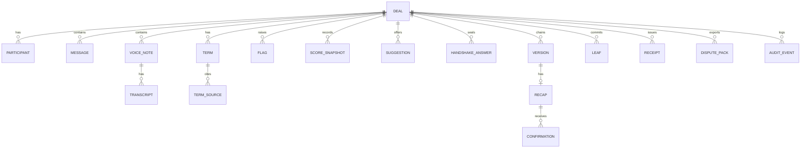

# Data Model

This document lists VeriDoc's entities, fields, relationships, retention, encryption and insert-only rules. Field names are indicative until `packages/contracts` is agreed by all four members.

Last updated: 2026-10-25
Status: Draft v1

## 1. Storage layout

| Item | Detail |
|---|---|
| Database | One SQLite file per vault, WAL mode, accessed through SQLAlchemy 2.0 |
| Schema changes | Alembic migrations in `packages/vault/migrations/`. Every schema change is a migration. |
| Evidence folder | Audio and attachments in an encrypted local folder. Each file is AES-GCM encrypted and **named by its hash** (the lowercase hex payload digest from INTEGRITY_SPEC section 5). Content-addressed, so identical files are stored once. |
| Object store | None in the MVP. MinIO or any S3-compatible store is roadmap only, for the cloud tier's share bundles. |
| Location | Inside the vault folder on the stick or laptop |
| Encryption | AES-GCM; key derived from the passphrase with Argon2id; a random data key is wrapped by the passphrase key and by the recovery key |
| Backups | The user copies the vault folder. No cloud sync in the MVP. |

## 2. Entity-relationship diagram

## 3. Entities

Types: `id` is a random UUID; `ts` is an ISO 8601 string with offset. "Insert-only" entities are protected by triggers that reject UPDATE and DELETE.

### Deal
| Field | Notes |
|---|---|
| id | |
| title | For example "Raju Traders x Meena Tailors" |
| playbook_key | `supply_order` or `freelance` |
| playbook_version | |
| me_participant_id | Which participant is the user |
| created_at | |
| status | draft, awaiting, confirmed |
| language | Recap language: en, hi (kn in P1) |

### Participant
`id`, `deal_id`, `display_name`, `role` (party, context), `is_me`.

### Message (insert-only)
`id`, `deal_id`, `seq`, `sender_participant_id`, `ts`, `text`, `attachment_id` (nullable), `is_system`, `source` (export, paste, simulator), `import_batch_id`.

### VoiceNote (insert-only)
`id`, `deal_id`, `seq`, `message_id`, `file_hash` (name of the encrypted evidence file), `duration_ms`, `audio_digest`, `status` (transcribed, not_transcribed, failed).

### Transcript (insert-only)
`id`, `voice_note_id`, `model`, `model_version`, `language`, `segments` (JSON: `start_ms`, `end_ms`, `text`, `confidence`), `created_at`, `supersedes_id` (nullable, for user corrections).

### Term
| Field | Notes |
|---|---|
| id | |
| deal_id | |
| key | From the playbook |
| value | Normalised |
| raw | Original wording |
| unit | |
| state | clear, ambiguous, missing, conflict |
| origin | rules, ai, both, user |
| confidence | high, medium, low |
| needs_review | boolean |
| confirmed_by_me_at | Nullable |
| acknowledged_by_other | boolean (set from FR-FLG-005) |

Terms are editable while unconfirmed. Once a term is part of a version it is copied into the version record; the version record is insert-only.

### TermSource
`term_id`, `kind` (message, voice_segment), `message_id` or `voice_note_id`, `start_ms`, `end_ms`, `quote`.

### Flag
`id`, `deal_id`, `type` (see PRD section 8.4), `term_key`, `reason` (plain-language text), `source_refs`, `created_at`, `resolved_at` (nullable).

### ScoreSnapshot (insert-only)
`id`, `deal_id`, `ts`, `score`, `breakdown` (JSON per term: weight, present, clear, acknowledged, points), `trigger`.

### Suggestion
`id`, `deal_id`, `target_term_keys`, `tone`, `text`, `created_at`, `copied_at` (nullable). Records only that the text was copied; VeriDoc cannot know if the user sent it.

### HandshakeAnswer (insert-only)
`id`, `deal_id`, `party`, `order` (1 or 2), `mode` (reply, handover), `answers` (encrypted JSON), `salt`, `seal_hash`, `sealed_at`, `revealed_at`.

Rule: a row with `order` 2 can be inserted only if a sealed row with `order` 1 exists for the deal and its `sealed_at` is earlier (FR-HSK-007).

### Version (insert-only)
`id`, `deal_id`, `n`, `terms_set` (canonical JSON), `terms_digest`, `root`, `link`, `prev_link`, `reason_message_id` (nullable), `created_at`.

### Recap (insert-only)
`id`, `version_id`, `language`, `lines` (JSON), `text`, `recap_hash`, `code`, `created_at`.

### Confirmation (insert-only)
`id`, `recap_id`, `party`, `state` (sent, confirmed, not_confirmed), `reply_text`, `reply_ts`, `sender_entered_by_user`, `leaf_id`, `checked_at`, `failure_reason` (nullable).

### Leaf (insert-only)
`id`, `deal_id`, `seq`, `type_byte`, `salt`, `payload_digest`, `leaf_hash`, `ref_table`, `ref_id`.

### Receipt (insert-only)
`id`, `deal_id`, `root`, `leaf_count`, `chain_head`, `recorded_at`, `anchor` (nullable JSON), `receipt_hash`.

### DisputePack
`id`, `deal_id`, `parts` (JSON list), `created_at`, `file_digest`, `masked` (boolean, P1).

### AuditEvent (insert-only)
`id`, `deal_id` (nullable), `ts`, `actor` (me, system), `action` (import, confirm_term, correct_term, reject_term, seal, reveal, create_version, send_recap, check_reply, export, setting_change, safe_mode_change, delete_deal), `detail` (JSON with ids and old and new values for corrections; never message text beyond what the term value requires).

## 4. Insert-only enforcement

- SQLite `BEFORE UPDATE` and `BEFORE DELETE` triggers on every insert-only table call `RAISE(ABORT, ...)`.
- The triggers live in an Alembic migration as raw SQL (`op.execute`), not in SQLAlchemy model code, so they are created and versioned with the schema and cannot be skipped by a model change. Each insert-only table's migration creates both triggers.
- SQLAlchemy models for insert-only tables expose no update or delete methods in the vault package API.
- The startup self-check verifies the triggers exist and abort a test write on a scratch table.
- The only exception is crypto-shredding (section 6), which removes the key rather than rows; encrypted rows remain but are unreadable.
- Integrity does not rely on triggers: tampering with the file directly is caught by the Merkle root and chain at verification.

## 5. Encryption

| Layer | Detail |
|---|---|
| Key derivation | Argon2id from the passphrase, with parameters stored in the vault header (values TBD, tuned for 8 GB laptops) |
| Data key | Random 256-bit key, wrapped by the passphrase-derived key and, separately, by a key derived from the recovery key |
| Records | AES-GCM with a unique nonce per record or file; deal id and record id as associated data |
| Recovery key | Generated once at setup, shown for printing, never stored in plain form. Losing both passphrase and recovery key means the data cannot be opened. |
| Plaintext on disk | None, apart from non-sensitive vault header fields |

## 6. Retention and deletion

| Data | Retention |
|---|---|
| Deals, evidence, receipts | Kept until the user deletes the deal. A legal retention period is `TBD` (lawyer to confirm). |
| Audit events | Kept for the life of the deal. |
| Deletion | "Delete deal" removes the deal's wrapped key (crypto-shredding), deletes evidence files and clears the deal's rows where the insert-only rule allows; a final audit event records the deletion without content. A receipt bundle already given to someone else is not affected. |
| Logs | Contain no content; rotated at a small fixed size. |

## 7. Evidence files

1. Path: `<vault>/evidence/<first two hex chars>/<full hex hash>`.
2. The name is the payload digest of the plaintext (audio bytes or attachment bytes). The file content is encrypted with AES-GCM, with the deal id and file hash as associated data.
3. On read, the vault decrypts and recomputes the digest; a mismatch is reported as a self-check failure.
4. Names reveal the hash of a file to anyone with disk access, so a known file could be recognised. This is accepted for the MVP (THREAT_MODEL T29); the folder is on an encrypted vault location chosen by the user.
5. Deleting a deal removes its files and its wrapped key.

## 8. Exports

Exports are written only by the user's action (receipt bundle, dispute pack). They are plain files outside the vault; the user is warned of this before export. The P1 privacy mask applies to exports, shares and any cloud call (see [PRIVACY](PRIVACY.md)).
