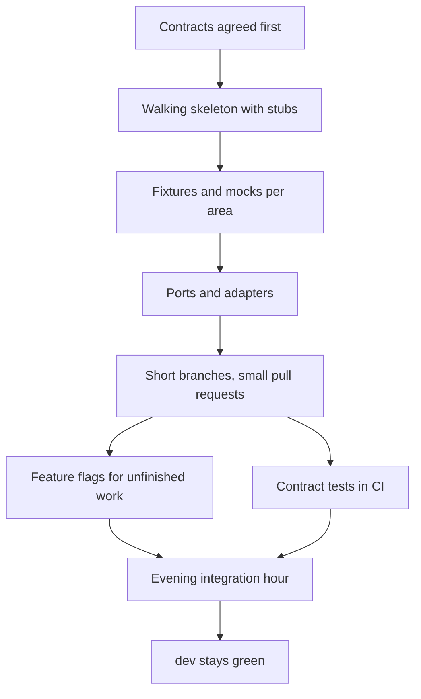

# Development Methodology

This document explains how four developers work in parallel on VeriDoc without blocking each other. Each practice has three parts: what it is, why we use it, and how we do it here. It is the long version of the merge-conflict rules in [TEAM_GUIDE](TEAM_GUIDE.md).

Last updated: 2026-10-25
Status: Draft v1

## 1. Contract-first development

**What.** The shapes of data that cross area boundaries are written down before feature code: Pydantic models in `packages/contracts` and the API shape in [ARCHITECTURE](ARCHITECTURE.md) section 10.

**Why.** Four people building four parts will only fit together if the joints are fixed first. Changing a joint later costs everyone.

**How here.**
1. On day 1 the team writes `packages/contracts` together: Message, VoiceNote, Term, Flag, Score, Suggestion, HandshakeAnswer, Recap, Confirmation, Version, Receipt, DisputePack.
2. A change later is its own small pull request, labelled `type:contracts`, reviewed by all four, merged before the feature code that needs it.
3. Breaking changes (renaming or removing a field) bump a `contract_version` and list every affected area in the pull request.
4. Prefer adding optional fields over changing existing ones.
5. Nobody changes a contract inside a feature pull request.

## 2. Walking skeleton

**What.** A thin end-to-end path through all four areas with stub logic: import a sample chat, receive fake terms, fake hashes, and show them on a screen.

**Why.** It proves the pieces connect on day one. Integration problems then appear when they are cheap, not in the last week.

**How here.**
1. Phase 0 task list in [PHASES](PHASES.md). Area 1 returns fixture messages. Area 2 returns fixture terms, flags and score. Area 3 returns a fake receipt with fixed fake hashes (clearly labelled fake). Area 4 shows it on screens S1 to S3 and the receipt.
2. The skeleton must run from a clean clone on all three operating systems.
3. After it works, each member replaces their stub with the real thing in small pull requests, keeping the path working every day.
4. Stub code is labelled as a stub and removed when replaced. The fake hashes can never be mistaken for real ones.

## 3. Mocks and shared fixtures

**What.** Each area publishes sample data that matches the contracts, in its own `fixtures/` folder inside its package (for example `packages/ingest/fixtures/`).

**Why.** The frontend can be built entirely before the API exists, and tests in one area do not need another area's real code.

**How here.**
1. One fixture per scenario, one file each (`ambiguous-chat.messages.json`, `delivery-ambiguous.term.json`).
2. A fixture must validate against the contract model; a contract test checks this in CI.
3. Fixtures are synthetic. No real chats, names or numbers.
4. The frontend loads fixtures through the same client it uses for the real API, switched by configuration (`VERIDOC_FEATURE_FLAGS`, see section 6).
5. When a contract changes, the owner of each fixture updates it in the same week.

## 4. Ports and adapters

**What.** Each area depends on an interface (a port), not on another area's internals. The real implementation and a fake are both adapters for that port.

**Why.** You can build and test your area without waiting for others, and tests stay fast and deterministic.

**How here.**
1. Examples of ports: the vault interface that ingest calls to store messages; the hashing interface; the model runner interface used by the intelligence package.
2. Ports are small Python protocols defined next to the code that uses them, with types from `packages/contracts`.
3. Tests inject a fake adapter. The intelligence package has no import of vault or hash code at all; it receives data and returns proposals (FR-AIS-001).
4. Area boundaries are crossed only through contracts and ports. Reaching into another package's private modules is not allowed.

## 5. Short-lived branches and small pull requests

**What.** One feature per branch, merged into `dev` within one to two days, under about 300 changed lines.

**Why.** Long branches drift from `dev` and cause large conflicts. Small pull requests are reviewed faster and better.

**How here.**
1. Split work until each piece can be merged on its own.
2. Open a draft pull request early so others see what is coming.
3. If a pull request grows past about 300 lines, split it. Generated files and fixtures do not count, but say so in the description.
4. Rebase on `dev` every morning.

## 6. Feature flags

**What.** Unfinished features merge early but stay switched off by a flag in configuration.

**Why.** It keeps branches short without exposing half-built features.

**How here.**
1. Flags are names listed in the `VERIDOC_FEATURE_FLAGS` setting (for example `blind_handshake`, `use_fixtures`).
2. Code checks the flag in one place near the entry point, not scattered.
3. A flag is removed when its feature is finished. Open flags are listed in the pull request that adds them.
4. P1 features stay behind flags until the MVP gate passes.
5. A flag never changes hashing, Merkle, version chain, echo code or verify behaviour; those have no flags.

## 7. Contract tests

**What.** Each area tests that its output matches the shared models.

**Why.** It finds a mismatch in the pull request that causes it, not in the integration hour.

**How here.**
1. Each package has a contract test inside its own `tests/` folder: it builds or loads its outputs and validates them with the Pydantic models.
2. Consumers have tests that load the producers' fixtures.
3. CI runs contract tests on every pull request.
4. A failing contract test blocks the merge.

## 8. Project board with a work-in-progress limit

**What.** A GitHub Project board lists all work. Each person has at most two tasks in progress.

**Why.** Finishing beats starting. Limits expose blockers early.

**How here.**
1. Columns: Backlog, Ready, In progress, In review, Done. Labels for area, phase and priority (`priority:mvp`, `priority:p1`). Details in [ONBOARDING](ONBOARDING.md) section 14.
2. Every pull request links to an issue (`Closes #N`).
3. Move your own card. If you are blocked, say so in the standup and add the `blocked` label.
4. Issues come from [PHASES](PHASES.md) checklists; a pull request ticks the box.

## 9. Daily rhythm

**What.** A fixed daily and weekly cycle.

**Why.** Predictable sync points replace constant interruptions.

**How here.**
1. Morning: rebase on `dev`, post the three-line async standup (done, doing, blocked).
2. Evening integration hour: all four online, merge ready pull requests, run the full suite on `dev`, fix breakage, pair on seams.
3. Weekly: a team demo of what runs on `dev`, followed by a backlog check against the phase gate.
4. Questions that block more than an hour go to the team chat at once.

## 10. Required CI checks

**What.** Automated checks that must pass before merging.

**Why.** They keep `dev` green and the hash path safe.

**How here.** Required on every pull request into `dev` and `main`:
1. ruff lint and format check
2. mypy type check
3. pytest for every package
4. contract tests
5. gitleaks secret scan (and pip-audit on the dependency pull request)
5a. `python scripts/check_hardcoding.py` (no hardcoded paths, localhost, ports, sample data or unmarked stubs)
5b. `python scripts/check_design_tokens.py` (screens use design tokens only, nothing loads from outside the device)
6. integrity tamper tests and the Python and JavaScript test-vector comparison
7. offline check (screens load with the network blocked), once the frontend exists

The CI workflow is `.github/workflows/ci.yml` (jobs `checks` and `secrets`, both required on `dev` and `main`). Run the same commands locally before pushing. Integrity tamper tests and the offline screen check join the workflow when those tests exist.

## 11. Pairing at integration seams

**What.** Short pair sessions (30 to 60 minutes) where two areas meet.

**Why.** Misunderstandings at joints are the main source of rework.

**How here.** Planned pairs (six seams):
1. **Verify page and hashing** (Hardik + Jhashank): the verify page must pass Jhashank's test vectors; they agree the receipt bundle format and run Python and JavaScript side by side.
2. **Model tiers and launcher** (Abhishek + Samanway): Abhishek sets tier thresholds and model choice; Samanway's launcher detects the tier and starts the right model; they test on the three laptops.
3. **AI output and the workspace screen** (Abhishek + Hardik): SSE events for terms, flags and score, and how needs-review is displayed.
4. **Recap and handshake with the vault** (Samanway + Jhashank): import commit and vault write; seal-before-submit for the Blind Handshake.
5. **Voice interface** (Abhishek + Samanway): the speech interface Abhishek owns and the import step that calls it; sample voice notes and time ranges.
6. **Contracts** (Jhashank + everyone): any contract change is shaped by the steward before the pull request.
Pairs agree the outcome in writing (a contract change, a fixture, an issue) before they part.

## 12. AI coding discipline

**What.** Rules for using Claude Code or Codex.

**Why.** Agents are fast and can change files they should not. The evidence layer must stay trustworthy.

**How here.**
1. Each agent session is scoped to one area and one task.
2. Ask the agent to write tests first, then code.
3. Agents read `CLAUDE.md` or `AGENTS.md`. They never push and never open pull requests.
4. A human reads the whole diff before committing, and runs tests locally.
5. If a change is needed in another area, in contracts, in `main.py` or in dependency files, the agent describes it and the human sends the request to the owner.
6. Never paste real chats, secrets or model weights into an agent session.

## 13. Merge-conflict reduction measures

These repository measures work together with the practices above.

| # | Measure | Detail |
|---|---|---|
| 1 | Router auto-discovery | `apps/api/main.py` loads every module in `apps/api/routers/` automatically (ADR-022), so nobody edits it to add a route. |
| 2 | Changelog fragments | Each pull request adds `changes/<branch-name>.md`. `CHANGELOG.md` is combined by the release lead (Hardik) at phase end. See `changes/README.md`. |
| 3 | Migrations owned by Area 3 | Other areas request schema changes in an issue. Area 3 (Jhashank) writes the Alembic migration. See below for multiple heads. |
| 4 | One dependency pull request per day | The dependency owner batches changes so `uv.lock` never conflicts. Others ask for a dependency in an issue. |
| 5 | Design tokens in one file | `apps/web/assets/design-tokens.css` is owned by Area 4 (Hardik). Every screen has its own CSS file. |
| 6 | `.gitattributes` | `* text=auto eol=lf` plus binary rules, so Windows and macOS line endings never create diffs. |
| 7 | `.editorconfig` | Consistent indentation and final newline. |
| 8 | Generated files never committed | Reports, OpenAPI dumps, build output, caches. `.gitignore` blocks them. |
| 9 | One file per item | One eval chat per file, one screen per folder, one playbook per file, one fixture per scenario. |
| 10 | Morning rebase and pull before you push | `git pull --rebase origin dev` at the start of the day and before every push. |

### Alembic multiple heads

Alembic keeps a chain of migrations. If two migrations are created from the same parent, there are two heads and `alembic upgrade head` fails. Because only Area 3 writes migrations, this should be rare. If it happens:
1. Run `alembic heads` to list the heads.
2. Run `alembic merge -m "merge heads" <head1> <head2>` to create a merge migration.
3. Run `alembic upgrade head` on a scratch vault and the insert-only trigger test.
4. Commit the merge migration in its own pull request, reviewed by Area 3.
Never edit a migration that is already on `dev`; add a new one.

## 14. Independent and integration issues

**What.** Every issue is independent or integration (label `type:integration`).

**Why.** Independent work should never wait for another person. Work that crosses areas needs one person who sees all the pieces, so seams are not merged in two different shapes.

**How here.**

| Issue type | How to recognise it | Who builds | Who merges | Reviewers |
|---|---|---|---|---|
| **Independent** | Touches only files in one area (the owner's own folders) and no seam | The area owner | The area owner, into `dev`, after CI passes | Optional: a teammate may review; not required for merge |
| **Integration** (label `type:integration`) | Touches two or more areas, `packages/contracts`, or a seam listed in DEVELOPMENT_METHODOLOGY section 11 (verify page and hashing, model tiers and launcher, AI output and workspace screen, recap and handshake with the vault, voice interface) | Hardik (area owners build their own part on a branch if useful) | Hardik, into `dev`, after CI passes | The affected area owners, who are also assignees |

1. An issue is independent only if it stays inside one owner's folders and touches no seam from section 11 and no contract.
2. Integration issues carry the owners of every affected area as assignees. Hardik builds and merges; owners may build their part on their own branch and open a pull request, which Hardik merges once the owners have reviewed.
3. Contracts are integration issues; all four review them (section 1).
4. `blocked` means the issue waits on a named pull request or issue; the reason is in a comment.
5. Nobody merges, closes or pushes to another person's pull request; comment instead.
6. CI (`checks` and `secrets`) must be green before any merge.
7. Pairing sessions (section 11) are how the owners of an integration issue agree the shape before Hardik builds it.

