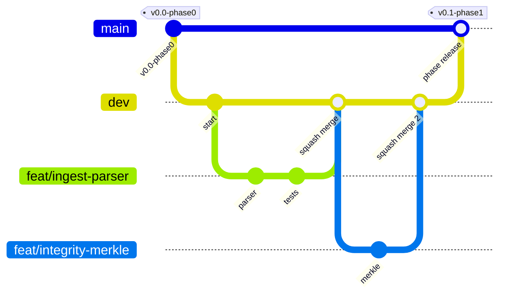

# Git Workflow

This document gives the full branch model with exact commands: creating a branch, syncing, rebasing, resolving a conflict, squash merges into `dev`, merging `dev` into `main` at the end of a phase, tags, hotfixes, the GitHub branch protection settings, and recovery steps for common accidents. Commands work in Git Bash or PowerShell on Windows, and in a terminal on macOS and Linux, unless a difference is shown.

Last updated: 2026-10-25
Status: Draft v1

Remote: `https://github.com/HARDIKSINGH150206/Veridoc.git` (called `origin`). Member names are `TBD`. See [ONBOARDING](ONBOARDING.md) for the beginner path and [TEAM_GUIDE](TEAM_GUIDE.md) for team rules.

## 1. Branch model



| Branch | Purpose | Who merges into it | How |
|---|---|---|---|
| `main` | Stable. Phase releases only. Always runnable. | Release lead (Area 4), after the phase gate in [RELEASE_CHECKLIST](RELEASE_CHECKLIST.md) | Pull request from `dev`, **merge commit** |
| `dev` | Integration. Every finished feature lands here. | Any member, after review | Pull request from a feature branch, **squash merge** |
| `feat/<area>-<name>` | One feature, from `dev` | Its author | Deleted after merge |
| `fix/<name>` | One bug fix, from `dev` | Its author | Deleted after merge |
| `docs/<name>` | Documentation, from `dev` | Its author | Deleted after merge |
| `chore/<name>` | Tooling and dependencies, from `dev` | Its author | Deleted after merge |
| `hotfix/<name>` | Urgent fix, from `main` | Release lead | Merged into `main`, then into `dev` |

Rules:
1. Never commit directly to `main` or `dev`. Both are protected.
2. Always branch from `dev`, never from `main` (except hotfixes).
3. Branch names use lowercase and dashes: `feat/ingest-android-parser`, `feat/integrity-merkle-tree`, `fix/parser-midnight-timestamp`. The area word after `feat/` is one of `ingest`, `intelligence`, `integrity`, `frontend`, or `shared`.
4. One feature per branch. Merge within one to two days.

Why: a stable `main` is the thing you demo. `dev` absorbs daily churn. Short branches keep conflicts small.

## 2. Daily commands

### Start the day: sync

```
git checkout dev
git pull --rebase origin dev
```

If you have a branch in progress:

```
git checkout feat/ingest-android-parser
git pull --rebase origin dev
```

(`pull.rebase true` makes `git pull` do this by default; see ONBOARDING section 6.)

### Create a branch

```
git checkout dev
git pull --rebase origin dev
git checkout -b feat/ingest-android-parser
```

### Commit

```
git add packages/ingest/
git commit -m "feat(ingest): parse Android export headers"
```

Do not use `git add .` blindly; check `git status` first so you never add generated files, secrets or large files.

### Push your branch

First push:

```
git push -u origin feat/ingest-android-parser
```

Later pushes:

```
git push
```

After a rebase you must update the remote branch (only your own branch):

```
git push --force-with-lease
```

`--force-with-lease` refuses if someone else pushed to your branch. Never force-push `main` or `dev` (they block it).

### Open a pull request into `dev`

```
gh pr create --base dev --title "feat(ingest): parse Android export headers" --body-file .github/pull_request_template.md
```

Or open it on GitHub. Fill in every part of the template. Link the issue (`Closes #12`) and the requirement IDs. Add a changelog fragment `changes/feat-ingest-android-parser.md`.

## 3. Rebase and conflict resolution

Conflicts happen when two people change the same lines. Small branches and one-owner folders make them rare. When one happens:

1. Start the rebase: `git pull --rebase origin dev`
2. Git stops and lists the conflicted files. Find them: `git status`
3. Open each file. You see:
   ```
   <<<<<<< HEAD
   (their version, already in dev)
   =======
   (your version)
   >>>>>>> your commit message
   ```
4. Edit the file to the correct final content. Delete the three marker lines.
5. Mark it resolved: `git add path/to/file`
6. Continue: `git rebase --continue`
7. Repeat if Git stops again.
8. Run the tests and linters locally.
9. Update your remote branch: `git push --force-with-lease`

If you are lost, abort and start over: `git rebase --abort`.

Special files:
- `uv.lock` conflict: do not edit by hand. Ask the dependency owner; they regenerate it with `uv lock`.
- `packages/contracts` conflict: stop and ask in the team chat; contract changes need all four reviewers.
- Alembic "multiple heads": see ONBOARDING section 22.
- A conflict in a folder you do not own means you edited outside your area. Undo that part and request the change from the owner.

## 4. Merging into `dev` (squash)

Feature branches are merged with **Squash and merge** on GitHub. All commits on the branch become one commit on `dev`, with the pull request title as its message. The title must therefore be a valid Conventional Commit, for example `feat(ingest): parse Android export headers (#12)`.

Before pressing merge:
1. Required checks pass (lint, types, tests, contract tests, secret scan, integrity tamper tests).
2. At least one reviewer from another area has approved (the technical minimum is 0 approvals while the team is small; the team rule is one review).
3. The branch is up to date with `dev`.
4. The changelog fragment is in the pull request.

After merge: delete the remote branch (GitHub offers a button) and the local one:

```
git checkout dev
git pull --rebase origin dev
git branch -d feat/ingest-android-parser
```

If `git branch -d` refuses because of the squash, use `git branch -D` after checking the pull request is merged.

## 5. Phase release: `dev` into `main`

Done by the release lead (Area 4) at the end of each phase, after the phase gate in [PHASES](PHASES.md) and [RELEASE_CHECKLIST](RELEASE_CHECKLIST.md) pass.

1. Freeze `dev` for the integration hour: no merges while the checklist runs.
2. Combine the changelog fragments into `CHANGELOG.md` in a `chore/changelog-phaseN` branch from `dev`, delete the fragments, and merge that pull request into `dev` first.
3. Open a pull request `dev` into `main`:
   ```
   gh pr create --base main --head dev --title "release: phase N" --body "Phase N gate: see RELEASE_CHECKLIST"
   ```
4. Merge with **Create a merge commit** (not squash), so `main` keeps the history of `dev`.
5. Tag the merge commit on `main`:
   ```
   git checkout main
   git pull --rebase origin main
   git tag -a v0.N-phaseN -m "Phase N: <theme>"
   git push origin v0.N-phaseN
   ```
6. Sync `dev` with the merge commit by opening a pull request from `main` into `dev` (merge commit; normally no file changes):
   ```
   gh pr create --base dev --head main --title "chore: sync main into dev after phase N" --body "No code change."
   ```
7. Everyone: `git checkout dev && git pull --rebase origin dev`.

### Tags

| Tag | Meaning |
|---|---|
| `v0.0-phase0` | Phase 0 Setup complete (walking skeleton runs) |
| `v0.1-phase1` | Phase 1 Foundation |
| `v0.2-phase2` | Phase 2 Core loop |
| `v0.3-phase3` | Phase 3 Agreement |
| `v0.4-phase4` | Phase 4 Proof and polish (demo build) |
| `v0.5-phase5` | Phase 5 P1 (if reached) |

Tags are annotated (`-a`). A tag is never moved or deleted after it is pushed. A hotfix to a release adds a letter: `v0.2-phase2a`.

## 6. Hotfixes

For a serious bug found on `main` (for example the demo build fails):

```
git checkout main
git pull --rebase origin main
git checkout -b hotfix/fix-startup-crash
# fix, with a test
git add <files>
git commit -m "fix(packaging): handle missing model folder"
git push -u origin hotfix/fix-startup-crash
gh pr create --base main --title "fix(packaging): handle missing model folder"
```

After it is merged into `main` (squash is fine here), bring it into `dev`:

```
git checkout dev
git pull --rebase origin dev
git checkout -b fix/backport-startup-crash
git cherry-pick <commit-sha-from-main>
git push -u origin fix/backport-startup-crash
gh pr create --base dev --title "fix(packaging): backport startup crash fix"
```

If the release lead prefers, open a pull request from `main` into `dev` instead of cherry-picking. Tag a hotfix release if it changes a released build.

## 7. GitHub settings to configure

Already set (2026-10-25): default branch `main`; protection on `main` and `dev` with a pull request required, 0 approvals, no force pushes, no deletion. Settings below are to be configured as the team grows. Owner of settings: TBD.

### Branch protection for `main`

| Setting | Value |
|---|---|
| Require a pull request before merging | On |
| Required approving reviews | 0 now; raise to 1 at the start of Phase 1 |
| Dismiss stale approvals on new commits | On (once approvals are required) |
| Require review from code owners | On once CODEOWNERS has real handles |
| Require status checks to pass | On once CI exists (lint, types, tests, contract tests, secret scan, tamper tests) |
| Require branches to be up to date | On |
| Require conversation resolution | On |
| Require linear history | Off (`main` uses merge commits) |
| Restrict who can push | Release lead only for hotfix merges |
| Allow force pushes | Off |
| Allow deletions | Off |
| Include administrators | Off now; On before the demo |

### Branch protection for `dev`

Same as `main`, with: required approving reviews 0 now and 1 from Phase 1; linear history On (squash merges only); status checks On once CI exists.

### Repository merge settings

| Setting | Value |
|---|---|
| Allow squash merging | On (default message: pull request title) |
| Allow merge commits | On (used only for `dev` into `main`) |
| Allow rebase merging | Off |
| Automatically delete head branches | On |
| Tag protection | Pattern `v*`: only the release lead may create tags |

Example commands (to be run by the repo owner; they change repo settings):

```
gh repo edit HARDIKSINGH150206/Veridoc --delete-branch-on-merge --enable-squash-merge --enable-merge-commit --enable-rebase-merge=false
```

## 8. Recovery steps

| Accident | Fix |
|---|---|
| Committed to `dev` or `main` locally by mistake (not pushed) | `git branch feat/<area>-<name>` (saves the work), then `git reset --hard origin/dev` (or `origin/main`), then `git checkout feat/<area>-<name>` |
| Committed on the wrong feature branch | `git log --oneline` to find the SHA; `git checkout correct-branch`; `git cherry-pick <sha>`; go back and `git reset --hard HEAD~1` on the wrong branch |
| Wrong commit message (not pushed) | `git commit --amend` |
| Need to undo the last commit, keep changes | `git reset --soft HEAD~1` |
| Pushed a bad commit to your branch | Fix forward with a new commit, or `git reset --hard <good-sha>` then `git push --force-with-lease` |
| Pushed a secret | Follow ONBOARDING section 21: rotate the secret first, then clean history with the maintainers |
| Pushed a large file | Remove it with a new commit; if it must leave history, ask the maintainers (history rewrite) |
| Rebase went wrong | `git rebase --abort`; if it already finished, `git reflog` then `git reset --hard <sha-before-rebase>` |
| Lost commits | `git reflog` lists where HEAD was; `git checkout -b rescue <sha>` |
| Deleted a branch by mistake | `git reflog` for the SHA, `git checkout -b <name> <sha>` |
| Messy local state | Save work: `git stash push -u -m "wip"`; restore: `git stash pop` |
| Local `dev` differs from `origin/dev` and you have no work to keep | `git fetch origin && git reset --hard origin/dev` (this discards local changes; check `git status` first) |

`git reset --hard` and `--force` can destroy work. Run `git status` and `git log --oneline -5` before using them.
