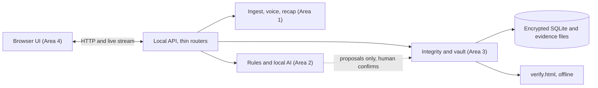
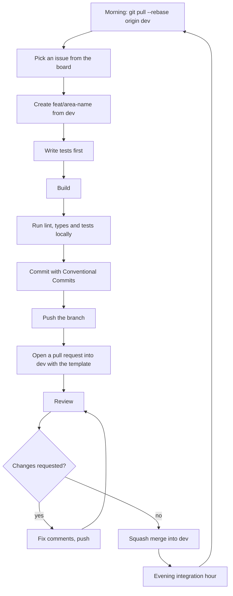

# Onboarding

This file takes a developer who has never seen VeriDoc from zero to a first merged pull request. It is written for a beginner: numbered steps, exact commands for Windows, macOS and Linux, and a short reason for each rule. Follow the sections in order. Members: Samanway (Area 1), Abhishek (Area 2), Jhashank (Area 3) and Hardik (Area 4).

Last updated: 2026-10-25
Status: Draft v1

Conventions: commands in a code block are typed into a terminal. On Windows use PowerShell (or Git Bash where it says so). On macOS use Terminal. On Linux use your terminal. Where a command differs by system, you see three labelled blocks. Commands that need code that does not exist yet are marked `TBD`; the team confirms them in [SETUP](SETUP.md) when the code lands.

## 1. Welcome

VeriDoc in five lines:
1. It reads a WhatsApp deal chat (and voice notes) on the user's own laptop.
2. It finds the key terms, links each one to its source message, and flags what is ambiguous, missing or contradictory.
3. It suggests one friendly next message, builds a plain-language recap, and the other side confirms with a short code in WhatsApp.
4. It keeps a tamper-evident record that anyone can check on an offline page.
5. It is a drafting and record-keeping aid, not legal advice.

**The problem (LS-06, From Handshake to Contract).** Small suppliers, freelancers and tutors close deals on WhatsApp. Price is in one message, the changed deadline is in a voice note, the payment term was never said. Asking for a contract feels legalistic, so people avoid it. When someone refuses to pay or deliver, the missing terms cannot be recovered.

**The flow: Handshake, Recap, Receipt.**
- Handshake: the two sides chat as usual, and VeriDoc watches for gaps.
- Recap: a short friendly summary goes to the other side, who replies `CONFIRM <code>`.
- Receipt: every message, voice note and agreement version is hashed and chained. Anyone can verify it offline.

**Example.** Raju (cloth wholesaler) and Meena (tailor) agree on 200 shirts at ₹480 each. Raju says "advance half now" and Meena sends ₹48,000. Meena says "delivery next week". Nobody says when the balance is due or what happens if delivery is late. VeriDoc marks delivery as Ambiguous, final payment and late penalty as Missing, and suggests: "Just to confirm, delivery by 15 Nov and the balance ₹48,000 on delivery, right?" (the date is an example). After Raju sends it and the answer arrives, the recap goes out, Meena replies `CONFIRM 7F3K`, and the receipt can be verified by anyone.

## 2. Read these first

Read them in this order. Plan about two hours. You do not need to memorise them; you need to know where things are.

| Document | Why it matters |
|---|---|
| [PRD](PRD.md) | What we build and the acceptance criteria. Every pull request links to its requirement IDs (for example `FR-IMP-001`). |
| [ARCHITECTURE](ARCHITECTURE.md) | The parts of the system, the folder tree, and who owns each folder. |
| [DECISIONS](DECISIONS.md) | Why we chose each technology. Read before proposing a change of tool. |
| [INTEGRITY_SPEC](INTEGRITY_SPEC.md) | Exact hashing rules. A mistake here breaks the evidence. Everyone should skim it. |
| [AI_SPEC](AI_SPEC.md) | How terms are extracted and why the AI can never write to the record. |
| [PHASES](PHASES.md) | What to work on now and what each phase must achieve. |
| [TEAM_GUIDE](TEAM_GUIDE.md), [GIT_WORKFLOW](GIT_WORKFLOW.md), [DEVELOPMENT_METHODOLOGY](DEVELOPMENT_METHODOLOGY.md) | How we work together. |
| [LIMITS](LIMITS.md) | The wording we must use on screen and in code comments. |
| [GLOSSARY](GLOSSARY.md) | Unknown word? Look here. |

## 3. Team and areas

The repository is split into four ownership areas so each person mostly edits their own folders. Members: Samanway (Area 1), Abhishek (Area 2), Jhashank (Area 3) and Hardik (Area 4).

| Area | Owns | Role | Member |
|---|---|---|---|
| 1. Ingest, Agreement and Release | `packages/ingest`, `apps/api/routers/ingest.py`, `apps/api/routers/agreement.py`, `playbooks/templates/`, `packaging/`, sample chats and demo voice notes | Ingest, agreement and release lead | Samanway (@notorious1337) |
| 2. AI and ML | `packages/intelligence`, `playbooks/` (except `playbooks/templates/`), `eval/`, `apps/api/routers/analysis.py` | AI and ML lead | Abhishek (@absksync) |
| 3. Backend, Integrity and Vault | `apps/api/main.py`, `packages/contracts` (steward), `packages/integrity` (except `packages/integrity/anchoring/`), `packages/vault`, `test-vectors/`, `apps/api/routers/vault.py`, `apps/api/routers/export.py`, `.github/workflows/`, `pyproject.toml`, `uv.lock` | Backend and integrity lead | Jhashank (@NYN-05, invitation pending; Hardik covers until accepted) |
| 4. Frontend and Blockchain | `apps/web`, `apps/verify`, `packages/integrity/anchoring/` | Frontend and blockchain lead; project release lead | Hardik (@HARDIKSINGH150206) |

Shared by all, changed only by small reviewed pull requests: `packages/contracts` (steward: Jhashank; every change still needs all four reviewers), `docs/`, `.github/` (except `.github/workflows/`, Area 3). Jhashank's invitation is pending; until it is accepted Hardik covers Area 3 work.

**Hotspots and who owns them (and why: one owner per hotspot means no two people edit the same file at once):**

| Hotspot | Owner | What you do instead of editing it |
|---|---|---|
| Contracts (`packages/contracts`) | All four, by pull request | Open a small contracts pull request, see section 16 |
| Dependency files (`pyproject.toml`, `uv.lock`) | Area 3 (Jhashank) | Open an issue asking for the dependency |
| Design tokens (`apps/web/assets/design-tokens.css`) | Area 4 (Hardik) | Ask in an issue |
| Migrations (`packages/vault/migrations/`) | Area 3 (Jhashank) | Open an issue describing the schema change you need |
| `apps/api/main.py` | Area 3 (Jhashank) | You never need to edit it: routers load automatically (ADR-022) |
| Release (merge `dev` into `main`, tags, changelog) | Hardik | Ask in the team chat |
| Hardware tier thresholds and model choice | Abhishek | Open an issue |

## 4. Access checklist

Ask Hardik (repo owner) if anything is missing.

- [ ] A GitHub account, with your name or a recognisable username
- [ ] Two-factor authentication turned on in GitHub (Settings, Password and authentication). Reason: the repo holds the evidence layer.
- [ ] An invitation to `HARDIKSINGH150206/Veridoc` accepted (check your email or github.com/notifications)
- [ ] Added to the team chat (platform TBD)
- [ ] Added to the project board (GitHub Projects, link TBD)
- [ ] Your GitHub handle is in `.github/CODEOWNERS` (current handles: `@notorious1337` Samanway, `@absksync` Abhishek, `@NYN-05` Jhashank, `@HARDIKSINGH150206` Hardik)

## 5. Install tools

You need: Git, GitHub CLI (`gh`), Python 3.11 or later, uv, VS Code, and optionally Claude Code or Codex. Node.js LTS is needed later for the JavaScript test vectors.

### Windows (PowerShell)

```
winget install --id Git.Git -e
winget install --id GitHub.cli -e
winget install --id Python.Python.3.11 -e
winget install --id Microsoft.VisualStudioCode -e
winget install --id OpenJS.NodeJS.LTS -e
powershell -ExecutionPolicy ByPass -c "irm https://astral.sh/uv/install.ps1 | iex"
```
Close and reopen PowerShell after installing. If `python` opens the Microsoft Store, turn off the "App execution aliases" for Python in Windows Settings, or use `py -3.11` instead. Check versions:
```
git --version
gh --version
python --version
uv --version
code --version
node --version
```

### macOS (Terminal, with Homebrew)

If you do not have Homebrew, install it from https://brew.sh first.
```
brew install git gh python@3.11 node
brew install --cask visual-studio-code
curl -LsSf https://astral.sh/uv/install.sh | sh
```
Check versions:
```
git --version
gh --version
python3 --version
uv --version
code --version
node --version
```
On Apple Silicon use the native arm64 tools (Homebrew does this by default). If `code` is not found, open VS Code, press Cmd+Shift+P and run "Shell Command: Install 'code' command in PATH".

### Linux (Ubuntu or Debian)

```
sudo apt update
sudo apt install -y git python3.11 python3.11-venv nodejs npm curl
curl -LsSf https://astral.sh/uv/install.sh | sh
```
If `python3.11` is not available on your release, use `uv python install 3.11` (uv downloads Python for you).

Install GitHub CLI from its official apt repository:
```
sudo mkdir -p -m 755 /etc/apt/keyrings
wget -qO- https://cli.github.com/packages/githubcli-archive-keyring.gpg | sudo tee /etc/apt/keyrings/githubcli-archive-keyring.gpg > /dev/null
sudo chmod go+r /etc/apt/keyrings/githubcli-archive-keyring.gpg
echo "deb [arch=$(dpkg --print-architecture) signed-by=/etc/apt/keyrings/githubcli-archive-keyring.gpg] https://cli.github.com/packages stable main" | sudo tee /etc/apt/sources.list.d/github-cli.list > /dev/null
sudo apt update
sudo apt install -y gh
```
Other distributions: https://github.com/cli/cli/blob/trunk/docs/install_linux.md.

Install VS Code:
```
sudo snap install --classic code
```
Other ways: https://code.visualstudio.com/docs/setup/linux. Restart the terminal, then check versions:
```
git --version
gh --version
python3 --version
uv --version
code --version
node --version
```

Expected: Git 2.30 or later, Python 3.11 or later. Why Python 3.11+: the project uses its typing features, and `pyproject.toml` will require it.

### VS Code extensions (recommended)

Install from the Extensions panel or with `code --install-extension <id>`:

| Extension | Id | Why |
|---|---|---|
| Python | `ms-python.python` | Run and debug |
| Ruff | `charliermarsh.ruff` | Same linter and formatter as pre-commit |
| Mypy Type Checker | `ms-python.mypy-type-checker` | Type errors as you type |
| EditorConfig | `editorconfig.editorconfig` | Respect `.editorconfig` |
| GitLens | `eamodio.gitlens` | See who changed a line |
| GitHub Pull Requests | `github.vscode-pull-request-github` | Review without leaving the editor |
| Markdown Mermaid | `bierner.markdown-mermaid` | Preview diagrams in docs |
| YAML | `redhat.vscode-yaml` | Playbooks are YAML |

### Claude Code or Codex (optional)

Both need Node.js (installed above). The npm commands are the same on Windows (PowerShell), macOS and Linux:
```
npm install -g @anthropic-ai/claude-code
npm install -g @openai/codex
```
Install only the one your area uses. On macOS and Linux, if npm reports a permission error, do not use `sudo`; set a user npm prefix (`npm config set prefix ~/.npm-global` and add `~/.npm-global/bin` to your `PATH`), or follow the official instructions (Claude Code: https://docs.claude.com/en/docs/claude-code; Codex: the OpenAI Codex CLI documentation). Check with `claude --version` or `codex --version`. They read `CLAUDE.md` or `AGENTS.md`. Read section 20 before using one.

## 6. Configure Git

Run once on your machine. Use the same email as your GitHub account (or GitHub's no-reply email, shown in GitHub Settings, Emails).

```
git config --global user.name "Your Name"
git config --global user.email "you@example.com"
git config --global init.defaultBranch main
git config --global pull.rebase true
git config --global rebase.autoStash true
git config --global push.autoSetupRemote true
```

Why `pull.rebase true`: `git pull` then puts your commits on top of the latest ones, which keeps history straight and avoids pointless merge commits.

**Line endings.** The repo has a `.gitattributes` that stores files with LF line endings. Tell Git not to convert them again:

| System | Command |
|---|---|
| Windows | `git config --global core.autocrlf false` |
| macOS and Linux | `git config --global core.autocrlf input` |

Why: mixed line endings make every line look changed and cause conflicts. Make VS Code use LF too: in Settings, search "eol" and choose `\n` (the `.editorconfig` also does this).

**Access: choose one.**

*Option A, GitHub CLI (easiest):*
```
gh auth login
```
Choose GitHub.com, HTTPS, "Login with a web browser", and follow the prompts. Then:
```
gh auth setup-git
```

*Option B, SSH key:*
```
ssh-keygen -t ed25519 -C "you@example.com"
```
Press Enter to accept the default file; set a passphrase. Then print the public key and add it in GitHub, Settings, SSH and GPG keys:

| System | Show the public key |
|---|---|
| Windows (PowerShell) | `Get-Content $env:USERPROFILE\.ssh\id_ed25519.pub` |
| macOS | `cat ~/.ssh/id_ed25519.pub` |
| Linux | `cat ~/.ssh/id_ed25519.pub` |

Start the SSH agent and add the key so you are not asked for the passphrase every time:

| System | Commands |
|---|---|
| Windows (PowerShell, run as administrator once) | `Get-Service ssh-agent \| Set-Service -StartupType Manual` then `Start-Service ssh-agent` then (normal PowerShell) `ssh-add $env:USERPROFILE\.ssh\id_ed25519` |
| macOS | `ssh-add --apple-use-keychain ~/.ssh/id_ed25519` |
| Linux | `eval "$(ssh-agent -s)"` then `ssh-add ~/.ssh/id_ed25519` |

**Verify access:**
```
gh auth status
```
Expected: "Logged in to github.com". With SSH also run `ssh -T git@github.com`; expected: "Hi <you>! You've successfully authenticated".

## 7. Clone and set up

```
git clone https://github.com/HARDIKSINGH150206/Veridoc.git
cd Veridoc
git checkout dev
```
Always work from `dev`. (With SSH use `git@github.com:HARDIKSINGH150206/Veridoc.git`.)

Next steps. The code does not exist yet, so the exact commands are `TBD`; the expected ones are shown and will be confirmed in [SETUP](SETUP.md). Git, `gh`, `uv` and `uv run` commands are identical on Windows, macOS and Linux; where a command differs, all three versions are shown.

1. **Install dependencies:** expected `uv sync` (TBD).
2. **Install pre-commit hooks:** `uv run pre-commit install`. The first commit afterwards downloads the hook tools, so it needs the internet once. Why: it runs ruff and the secret scan on every commit so mistakes never leave your machine.
3. **Copy the environment file:**

| System | Command |
|---|---|
| Windows | `Copy-Item .env.example .env` |
| macOS and Linux | `cp .env.example .env` |

   `.env` is git-ignored. Never commit it. Set `VERIDOC_HOME` to a folder outside the repo.
4. **Download models and verify their hashes.** Models are not in Git. `models/manifest.json` lists names and SHA-256 hashes only (exact models are TBD pending benchmarks). Download each listed file from its official source into your `VERIDOC_MODEL_DIR`, then check it:

| System | Check a file |
|---|---|
| Windows | `Get-FileHash <file> -Algorithm SHA256` |
| macOS | `shasum -a 256 <file>` |
| Linux | `sha256sum <file>` |

   The output must equal the hash in the manifest. If not, delete the file and download again. Why: a swapped model could change results.
5. **Run the tests to confirm the setup:** expected `uv run pytest` (TBD). All tests should pass on a fresh clone. If they do not, ask for help (section 23) before changing anything.
6. **Check the folder layout** (works today). Expected last line: `OK`.

| System | Command |
|---|---|
| Windows | `python scripts\check_folder_tree.py` |
| macOS | `python3 scripts/check_folder_tree.py` |
| Linux | `python3 scripts/check_folder_tree.py` |

## 8. Repository tour

```
Veridoc/
├── apps/
│   ├── api/                    FastAPI app, thin layer of routes only
│   │   ├── main.py             loads routers automatically; Area 3 only
│   │   ├── settings.py         the one settings module; Area 3
│   │   └── routers/
│   │       ├── ingest.py       Area 1: import and voice
│   │       ├── agreement.py    Area 1: recap and Blind Handshake
│   │       ├── analysis.py     Area 2
│   │       ├── vault.py        Area 3
│   │       └── export.py       Area 3
│   ├── web/                    Area 4: screens, components, bundled assets (no CDN)
│   └── verify/                 Area 4: standalone offline verify.html
├── packages/
│   ├── contracts/              shared schemas, the ONLY shared code (all four, by PR)
│   ├── ingest/                 Area 1: parser, media, voice import wiring, recap builder, Blind Handshake logic
│   ├── intelligence/           Area 2: rules, local AI, flags, score, suggestion, speech runner (speech/)
│   ├── integrity/              Area 3: hashing, Merkle, version chain, echo code; anchoring/ is Area 4
│   └── vault/                  Area 3: SQLite, encryption, audit table, migrations, dispute pack
├── playbooks/                  Area 2: YAML playbooks
│   └── templates/              Area 1: recap and suggestion templates (en, hi)
├── eval/                       Area 2: eval chats, labels, runner, reports (ignored)
├── test-vectors/integrity/     Area 3: hashes Python and JavaScript must both match
├── packaging/                  Area 1: launchers, runtimes, tier detection, end-to-end tests
├── models/manifest.json        model names and SHA-256 only
├── scripts/                    dev helpers (folder check, test vectors, trust report)
├── changes/                    changelog fragments, one per pull request
├── docs/                       all documentation
└── .github/                    CODEOWNERS, templates, workflows
```
Each package has its own `tests/` folder. There is no shared top-level tests folder, so a package owner always finds tests next to the code. Full details: [ARCHITECTURE](ARCHITECTURE.md) section 9.

## 9. The architecture in one picture



Everything runs on the user's laptop with no internet. The browser shows screens. The local API passes work to the packages. The AI and rules only propose terms; a person confirms each one; only then does the integrity engine hash it into the vault. A separate static page, `verify.html`, can check an exported receipt without any server.

## 10. The development workflow, end to end



Steps with commands:

1. **Morning rebase.** `git checkout dev` then `git pull --rebase origin dev`. Why: start from the latest shared code.
2. **Pick an issue.** From the board, take a card from "Ready" in your area and phase. Move it to "In progress". Respect the limit of two tasks in progress.
3. **Create a branch from `dev`.** `git checkout -b feat/ingest-android-parser` (area word: `ingest`, `intelligence`, `integrity`, `frontend`).
4. **Write tests first.** Put them in the package's own `tests/` folder. They fail at first. Why: tests define "done" and protect the evidence layer.
5. **Build** the smallest piece that makes the tests pass.
6. **Run checks locally:** `uv run ruff check .`, `uv run ruff format --check .`, `uv run mypy .`, `uv run pytest` and `python scripts/check_hardcoding.py` (on Windows `python scripts\check_hardcoding.py`). The hardcoding check must pass: see section 19. Pre-commit also runs on commit.
7. **Commit** small and often with Conventional Commits (section 12).
8. **Add a changelog fragment** `changes/feat-ingest-android-parser.md` (see `changes/README.md`).
9. **Push.** First time: `git push -u origin feat/ingest-android-parser`.
10. **Open a pull request into `dev`** with `gh pr create --base dev` or on GitHub. Fill in the template.
11. **Review.** A teammate from another area reviews the same day (section 13).
12. **Fix comments.** Push more commits to the same branch; reply to each comment.
13. **Merge** with "Squash and merge" into `dev`. Delete the branch.
14. **Evening integration hour.** Everyone merges what is ready, runs the full suite on `dev`, and fixes anything broken.

## 11. Branch model

| Branch | What it is | Who may merge into it |
|---|---|---|
| `main` | Stable. Phase releases only. Always runnable. | Release lead (Hardik, Area 4), by pull request from `dev`, after the phase gate |
| `dev` | Integration. All finished features land here. | Anyone, by pull request, after review and green checks |
| `feat/<area>-<name>`, `fix/<name>`, `docs/<name>`, `chore/<name>` | Your work, from `dev` | You, then it is deleted |
| `hotfix/<name>` | Urgent fix, from `main` | Release lead |

- You cannot push directly to `main` or `dev`. GitHub branch protection requires a pull request and blocks force pushes and deletion.
- At the end of each phase the release lead merges `dev` into `main` and adds a tag `v0.N-phaseN` (for example `v0.1-phase1`).
- Why: `main` is what you demo and must never be broken; `dev` takes the daily churn.
- Full commands: [GIT_WORKFLOW](GIT_WORKFLOW.md).

## 12. Commits and pull requests

**Commit format (Conventional Commits):** `type(scope): short summary`, lowercase, no full stop, under about 72 characters.

| Type | Use | Example |
|---|---|---|
| `feat` | New behaviour | `feat(ingest): parse iPhone export headers` |
| `fix` | Bug fix | `fix(integrity): normalise line endings before hashing` |
| `test` | Tests only | `test(integrity): add odd-leaf Merkle vector` |
| `docs` | Docs only | `docs: add reply mode to handshake flow` |
| `refactor` | No behaviour change | `refactor(vault): split audit helpers` |
| `chore` | Tooling, deps | `chore: bump ruff` |
| `perf` | Speed | `perf(intelligence): cache compiled patterns` |

Why: a readable history, and tools can build the changelog.

**Pull request size.** Aim for under about 300 changed lines. Generated files and fixtures do not count; say so. If it is bigger, split it. Why: big pull requests are reviewed badly and conflict more.

**A pull request description must contain** (the template asks for each):
1. Summary: what and why, two or three sentences.
2. Area and phase.
3. Linked issue (`Closes #N`) and requirement IDs (for example `FR-IMP-001`).
4. Whether contracts changed.
5. How you tested it.
6. Checklist from the definition of done.
7. A changelog fragment in `changes/`.

## 13. Code review

**How to review.** Read the description first, then the tests, then the code. Run it if you can. Be kind and specific: say what and why, and suggest a fix. Use GitHub's "Request changes" only for things that must change; use comments for suggestions.

**Checklist for reviewers:**
- [ ] Linked to an issue and requirement IDs; the change matches them
- [ ] Tests exist, were written for the behaviour, and pass; contract tests pass
- [ ] Only files in the author's area changed (or the change is a reviewed contracts or docs change)
- [ ] No secrets, real chats, model weights or large files
- [ ] No message content or identifiers in logs or errors
- [ ] Wording follows LIMITS (tamper-evident, targets are targets)
- [ ] Hashing, Merkle, chain, echo code or verify changes also update INTEGRITY_SPEC and test vectors
- [ ] The AI layer does not write to the vault or hash path
- [ ] No hardcoding: no paths, ports, URLs or model names in code (settings module only); no sample names or amounts in logic; every stub marked `# STUB: replaced by #<issue>`; `check_hardcoding.py` passes
- [ ] Docs updated; threat model row updated for any new input or boundary
- [ ] Changelog fragment present

**Response time.** Review the same day you are asked. If you cannot, say so and name someone else.

**Deciding.** Approve when the checklist passes. Request changes when something on it fails. The author replies to each comment and re-requests review after fixing. The author merges (squash) after approval, unless the team decides otherwise.

## 14. The project board

GitHub Projects (link TBD).

| Column | Meaning |
|---|---|
| Backlog | Known work, not yet ready |
| Ready | Clear, small, has acceptance criteria; any matching person may take it |
| In progress | Someone is working on it (at most two per person) |
| In review | A pull request is open |
| Done | Merged into `dev` |

**Labels.** Area (`area:1-ingest-release`, `area:2-ai-ml`, `area:3-backend-integrity`, `area:4-frontend-blockchain`), phase (`phase:0` to `phase:5`), priority (`priority:mvp`, `priority:p1`), type (`type:task`, `type:bug`, `type:contracts`). Shared work carries only phase, priority and type labels. Add `blocked` when you are waiting on someone.

**How to pick a task.** Take the top card in Ready that is in your area and the current phase. Tick off the matching box in [PHASES](PHASES.md) in your pull request. Move your own card. If you are blocked, add the `blocked` label and say so in the standup.

**Work-in-progress limit:** at most two cards in progress per person. Why: finishing work beats starting more.

## 15. Phases

The project moves through Phase 0 Setup, 1 Foundation, 2 Core loop, 3 Agreement, 4 Proof and polish, and 5 P1 if time allows. The current phase is stated at the top of [PHASES](PHASES.md) (at the time of writing: Phase 0, not started). Each phase lists tasks per area as checkboxes, then a gate: the checks that must pass before `dev` is merged into `main`. Work on the current phase; do not start P1 work before the Phase 4 gate. Drop order if time runs short: share link, Blind Handshake, Kannada, pendrive tiers.

## 16. Contracts

`packages/contracts` holds the shared Pydantic models that cross area boundaries: Message, VoiceNote, Term, Flag, Score, Suggestion, HandshakeAnswer, Recap, Confirmation, Version, Receipt, DisputePack. It is the only shared code. Why it comes first: all four areas build against these shapes, so they must be agreed before feature code.

**To propose a change, exactly:**
1. Open an issue labelled `type:contracts` describing the need and the affected areas.
2. Branch from `dev`: `git checkout -b feat/shared-contract-<name>`.
3. Change only `packages/contracts` (and the fixtures that must follow, with their owners' agreement). Prefer adding optional fields over renaming or removing.
4. Add or update the contract tests.
5. Open a pull request into `dev` labelled `type:contracts`. Request review from all four members.
6. All four approve. Then merge.
7. Feature code that needs the change comes in a separate, later pull request.

## 17. Working in parallel

Full explanation: [DEVELOPMENT_METHODOLOGY](DEVELOPMENT_METHODOLOGY.md). Short version:
- **Fixtures and mocks.** Each package keeps sample data in its own `fixtures/` folder, matching the contracts. The frontend builds against fixtures until the API is ready.
- **Feature flags.** Unfinished work merges early but stays switched off (setting `VERIDOC_FEATURE_FLAGS`).
- **Adapters.** You depend on an interface, not on another area's internals, and tests plug in a fake.
- **Walking skeleton.** A thin end-to-end path with stub logic runs from day one; you replace your stub with the real thing in small pull requests.

## 18. Testing expectations

- **Where tests live:** inside the package they test, in `packages/<name>/tests/`. Never add a shared top-level tests folder.
- **What must be tested:** every requirement you implement, against the Given/When/Then criteria in the PRD; error paths and edge cases named there; anything that touches money, dates or hashes.
- **Write tests first.**
- **Contract tests:** every package checks its outputs against `packages/contracts`. CI runs them on every pull request.
- **Integrity test vectors:** Area 3 generates vectors with `scripts/make_test_vectors.py` into `test-vectors/integrity/`; Python and JavaScript must both reproduce them. The tamper tests (seven cases in INTEGRITY_SPEC section 11) must always pass.
- **Offline check:** every screen must load with the network blocked.
- **Run the full suite:** expected `uv run pytest` plus the JavaScript vector test (commands TBD in SETUP). Run it before opening a pull request.
- **Only synthetic data** in tests. No real chats.

## 19. Integrity rules

The non-negotiables from `CLAUDE.md`, in plain words:

1. **Never push straight to a shared branch or open pull requests from an AI tool.** Agents commit locally; a human pushes.
2. **No secrets, `.env` files, model weights or real chats in Git.**
3. **The AI only suggests.** It must never write into the vault or hash path. A person confirms every term first. Why: models make mistakes, and the record must stay trustworthy.
4. **Changing hashing, Merkle, the version chain, the echo code or the verify page?** Update `docs/INTEGRITY_SPEC.md` and the test vectors in the same pull request, and keep every tamper test passing. Why: Python and JavaScript must agree exactly or verification breaks.
5. **Never log message content, transcripts or names.** Log counts and error codes only.
6. **Say "tamper-evident".** Never use the opposite claim in code comments or screen text. Call the export a "court-ready evidence package".
7. **Accuracy and speed numbers are targets** until a trust report measures them.
8. **Follow the drop order** and do not start P1 before the MVP passes.
9. **Stay in your area.** Describe changes needed elsewhere; do not make them.
10. **Tests live inside their package.**
11. **No hardcoding.** Configuration comes only from the settings module (`apps/api/settings.py`); business rules live in playbooks, templates and `models/manifest.json`; stubs and fixtures live only in tests or demo mode and are marked `# STUB: replaced by #<issue>`; code never depends on sample names, amounts or dates. Why: hardcoded values break on someone else's machine and hide rules that should be reviewable data. `python scripts/check_hardcoding.py` checks it.
12. **If unsure, stop and ask,** and add the question to [OPEN_QUESTIONS](OPEN_QUESTIONS.md).

## 20. Using Claude Code and Codex

- **Stay inside your area.** Start the tool in the repo, tell it which area you work in, and tell it to touch only those folders. It reads `CLAUDE.md` or `AGENTS.md`.
- **Ask for tests first.** "Write failing tests for FR-IMP-001, then implement."
- **Never let it push** or open pull requests. It commits locally. You push.
- **Review every diff yourself** before you commit: `git diff`. Read all of it. Run the tests.
- **Never paste** real chats, secrets or model files into a session.
- **Handing off a change needed in another area.** Ask the agent to write a short description (what, why, file, proposed change). Post it as an issue for the owner (Area label), or in the team chat. Do not apply it yourself.
- **Contracts, `main.py`, dependency files and migrations** are never edited by your agent; describe the change instead.

## 21. Security and data

- No secrets, tokens, passphrases or recovery keys in Git, issues, pull requests or chat. `.env` is ignored. Only `.env.example` (names, no values) is committed.
- No real chats or voice notes: use the synthetic samples. Real data contains other people's details.
- No model weights in Git. `models/manifest.json` has names and hashes only.
- Report vulnerabilities privately: see [SECURITY](../SECURITY.md).

**If you pushed a secret:**
1. **Do not delete the commit and hope.** Treat the secret as public.
2. **Revoke or rotate it immediately** (change the password, delete the token or key).
3. Tell the team in the chat right away.
4. Remove it from the code in a new commit.
5. Ask the maintainers to clean the Git history if needed.
6. Add a note to the incident list (location TBD).

## 22. Common mistakes and fixes

| Mistake | Fix, step by step |
|---|---|
| **Committed to the wrong branch** (for example `dev`), not pushed | 1. `git branch feat/<area>-<name>` saves your work. 2. `git reset --hard origin/dev` resets `dev`. 3. `git checkout feat/<area>-<name>`. |
| **Committed on the wrong feature branch** | 1. `git log --oneline` and copy the SHA. 2. `git checkout correct-branch`. 3. `git cherry-pick <sha>`. 4. Back on the wrong branch: `git reset --hard HEAD~1`. |
| **Merge conflict** | 1. `git pull --rebase origin dev`. 2. `git status` lists conflicted files. 3. Open each; between `<<<<<<<` and `>>>>>>>` choose the right final content and delete the marker lines. 4. `git add <file>`. 5. `git rebase --continue`. 6. Run tests. 7. `git push --force-with-lease`. If lost: `git rebase --abort`. Conflict in `uv.lock` or `packages/contracts`: stop and ask. |
| **Rebase went wrong** | While rebasing: `git rebase --abort`. If finished: `git reflog`, find the line before the rebase, `git reset --hard <that-sha>`. |
| **Pre-commit hook fails** | Read the message. For ruff formatting: run the formatter (expected `uv run ruff format .`) then `git add` the changes and commit again. For a lint error: fix it. For gitleaks: you have a secret or secret-like string; remove it (see section 21). Never use `--no-verify` to skip hooks. |
| **Alembic multiple heads** (`alembic upgrade head` complains) | Only Area 3 creates migrations. If it happens, tell Area 3. They run `alembic heads`, then `alembic merge -m "merge heads" <head1> <head2>`, test on a scratch vault, and open a pull request. Never edit a migration already on `dev`. |
| **Line-ending noise** (every line shows as changed) | 1. Check `git config core.autocrlf` (Windows `false`, macOS and Linux `input`). 2. Make your editor use LF. 3. `git add --renormalize .` then `git status`. 4. If the diff is still noisy, ask for help before committing. |
| **Accidentally committed a large file or generated file** | Not pushed yet: `git rm --cached <file>`, add it to `.gitignore` if it is a type that should be ignored, `git commit --amend`. Already pushed: remove it with a new commit and tell the maintainers if it must leave history. |
| **Your branch is far behind `dev`** | `git pull --rebase origin dev` and resolve conflicts one commit at a time. Next time, rebase every morning. |
| **Working in a folder you do not own** | Undo those edits (`git checkout -- <path>`) and ask the owner. |

## 23. Getting help

| Need | Ask |
|---|---|
| Git, GitHub, branch protection, releases | Hardik (release lead) |
| Import, parsing, recap templates, Blind Handshake, packaging, launcher, benchmarks, demo runbook | Samanway (Area 1) |
| Rules, AI, voice transcription model, flags, score, playbooks, eval, model and tier choice | Abhishek (Area 2) |
| Hashing, vault, encryption, migrations, API main, CI, dependencies, contracts | Jhashank (Area 3; Hardik covers until the invitation is accepted) |
| Screens, design tokens, verify page, anchoring | Hardik (Area 4) |
| Dependencies | Jhashank (Area 3) |
| Legal wording or privacy | Do not guess. Add to OPEN_QUESTIONS; a lawyer must confirm. |

**How to write a good question.** Say: what you wanted to do; the exact command you ran; the exact error (copy and paste text, not a photo); what you already tried; your OS and branch. Do not paste secrets or real chats. Ask in the team chat, not in a private message, so others can learn. If you are stuck for more than an hour, ask.

## 24. First-day checklist

- [ ] I read PRD summary, ARCHITECTURE, PHASES and this file
- [ ] My GitHub account has two-factor authentication
- [ ] I accepted the repo invite and joined the team chat and the project board
- [ ] I installed Git, GitHub CLI, Python 3.11+, uv, VS Code
- [ ] I configured Git (name, email, `pull.rebase true`, line endings)
- [ ] `gh auth status` shows I am logged in
- [ ] I cloned the repo and checked out `dev`
- [ ] I ran the folder check (`python scripts\check_folder_tree.py` on Windows, `python3 scripts/check_folder_tree.py` on macOS and Linux) and saw `OK`
- [ ] I installed dependencies and pre-commit hooks (when available)
- [ ] I copied `.env.example` to `.env` (and did not commit it)
- [ ] I downloaded the models and verified their hashes (when available)
- [ ] The tests pass on my machine (when available)
- [ ] I know my area and the folders I own
- [ ] I created a branch from `dev` and opened a draft pull request for a tiny change (for example fixing a typo in the docs, or ticking my name into the team list when it exists)
- [ ] My first pull request is merged into `dev`

## 25. FAQ

**Why do we branch from `dev` and not `main`?** `main` only changes at the end of a phase. `dev` is where today's work meets.

**Can I push straight to `dev`?** No. Open a pull request, even for a one-line change.

**Why is the code not there yet?** We are in the documentation and setup phase. Phase 0 builds the skeleton.

**What if I need a new library?** Open an issue for Jhashank (Area 3). Dependency changes are batched once a day.

**What if I need a new field in a model?** Follow section 16.

**What if I need a database change?** Ask Jhashank (Area 3) in an issue. They write the migration.

**Can I use the Hindi or Kannada text I wrote?** Only after a native speaker reviews it (OPEN_QUESTIONS Q-17, Q-18). Mark it as a draft until then.

**What can I say about accuracy or speed?** Only what a trust report measured. Everything else is a target.

**Is VeriDoc legal advice?** No. It is a drafting and record-keeping aid. A lawyer must confirm any statement about Indian law.

**Where is the dictionary of terms?** [GLOSSARY](GLOSSARY.md).

**Who decides when a phase is done?** The phase gate in [PHASES](PHASES.md) and [RELEASE_CHECKLIST](RELEASE_CHECKLIST.md); the release lead merges.
