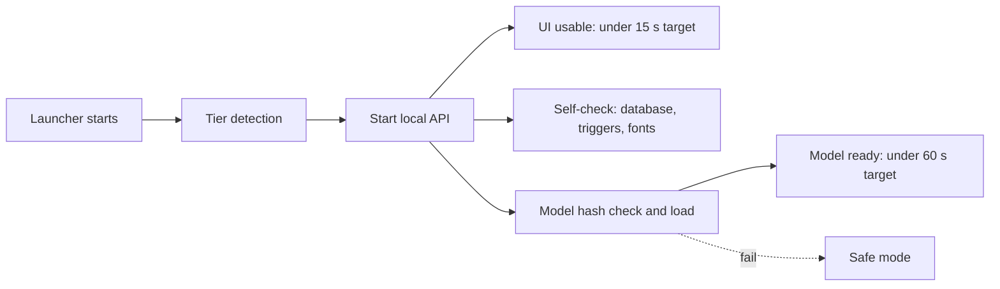

# Performance

This document defines VeriDoc's hardware tiers, startup and latency targets, and the benchmark protocol on three laptops. Every number is a **target** until measured; measured results go into a table here with the date and commit.

Last updated: 2026-10-25
Status: Draft v1

## 1. Hardware tiers

Chosen at startup by tier detection in `packaging/`.

| Tier | Detection | Extraction model | Speech model |
|---|---|---|---|
| High | 16 GB RAM or more | About 7B, 4-bit (TBD) | small |
| Default | 8 GB RAM | About 3B, 4-bit (TBD) | small |
| Low | 4 to 8 GB RAM, or old CPU (no AVX2, or a very low benchmark score) | About 1.5B, 4-bit (TBD) | base |
| Safe | Below the Low tier, or the model check failed, or the switch is on | None (rules only) | None |

The 8 GB tier is the default for the demo. The user can force a lower tier or safe mode in S11.

## 2. Targets

| ID | Metric | Target |
|---|---|---|
| NFR-PERF-001 | App usable from USB 3 | Under 15 s |
| NFR-PERF-002 | Model ready | Under 60 s |
| NFR-PERF-003 | Rules result per message | Under 0.1 s |
| NFR-PERF-004 | AI refinement | Under 10 s on an 8 GB laptop |
| NFR-PERF-005 | 30-second voice note | About 15 s on an 8 GB laptop |
| Extra | Import of a 150-message chat to first rules result | Under 2 s (target) |
| Extra | Vault write of an import (hashing, tree) for 150 messages | Under 1 s (target) |
| Extra | Verify page for 1,000 leaves | Under 2 s (target) |
| Extra | Dispute pack PDF of about 14 pages | Under 10 s (target) |

"Usable" means the deals list is shown and the rules engine works. Model loading continues in the background.

## 3. Startup sequence

## 4. Benchmark protocol

Run on **three laptops** that cover the tiers. Machines are `TBD`; record exact CPU, RAM, storage and OS.

| Laptop | Role | Needed spec |
|---|---|---|
| L1 | High tier | 16 GB RAM or more |
| L2 | Default tier (demo target) | 8 GB RAM, ordinary CPU |
| L3 | Low tier | 4 to 8 GB RAM, old CPU |

Procedure for each laptop and each of Windows, macOS and Linux where available:

1. Fresh boot; close other apps; plug in power; disable power saving.
2. Copy the build to a USB 3 stick (exFAT). Record the stick model and its read speed.
3. **Cold start x5:** power cycle the app, time launch to usable UI (NFR-PERF-001). Report median and worst.
4. **Model ready x5:** time to model ready (NFR-PERF-002).
5. **Rules latency:** run the rules engine over 1,000 messages from eval; report p50 and p95 per message (NFR-PERF-003).
6. **AI refinement x20:** on the ambiguous sample chat; report p50 and p95 (NFR-PERF-004).
7. **Voice x10:** a 30-second Hindi note and a 30-second English note; report time (NFR-PERF-005).
8. **Memory:** peak resident memory during steps 6 and 7.
9. **Eval run:** the full trust report on this tier; accuracy by tier.
10. **Antivirus check (Windows):** launch with the default antivirus on; note any block.
11. **Stick removal test:** pull the stick during an import; on reinsert, the vault must pass the self-check.

Record results in the table below. Do not edit target rows; add result rows.

| Date | Commit | Laptop | OS | Tier | Metric | Result | Pass or fail |
|---|---|---|---|---|---|---|---|
| TBD | TBD | TBD | TBD | TBD | TBD | TBD | TBD |

## 5. Rules for reporting

1. Quote only measured numbers, with laptop, tier, date and commit.
2. A missed target is reported as missed, and the tier or model choice is revised in an ADR.
3. Model choice per tier is decided by this benchmark plus the accuracy report; the decision is recorded in [DECISIONS](DECISIONS.md).
