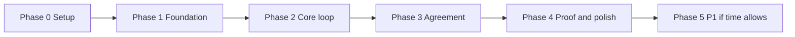

# Phases

This document breaks the build into phases 0 to 5, with per-area task checklists and the gate each phase must pass before `dev` is merged into `main`. It also defines the daily rhythm. Calendar dates are `TBD` (see OPEN_QUESTIONS Q-11).

Last updated: 2026-10-25
Status: Draft v1

**Current phase: Phase 0 (Setup), not started.** Update this line when a phase gate passes.

How to read this file: each phase has one checklist per area, then the gate. Tick a box in the pull request that finishes the task. Requirement IDs link to [PRD](PRD.md). Tags and release steps are in [GIT_WORKFLOW](GIT_WORKFLOW.md). Drop order if time runs short: share link, Blind Handshake, Kannada, pendrive tiers. Never drop import, term extractor, flags, chat recommendation, recap, vault, verify page. P1 work starts only after the MVP gate passes.

| Area | Name | Member |
|---|---|---|
| 1 | Ingest, Agreement and Release | Samanway (@notorious1337) |
| 2 | AI and ML | Abhishek (@absksync) |
| 3 | Backend, Integrity and Vault | Jhashank (@NYN-05); invitation pending, Hardik covers until accepted |
| 4 | Frontend and Blockchain | Hardik (@HARDIKSINGH150206); project release lead |

## Daily rhythm

| When | What |
|---|---|
| Morning | `git pull --rebase origin dev` on your branch. Post the async standup (three lines: done, doing, blocked). |
| During the day | One task at a time, at most two in progress per person. Small commits. Open the pull request early as a draft. |
| Review | Review other people's pull requests the same day. |
| Evening integration hour | Fixed hour, all four online. Merge ready pull requests into `dev`, run the full suite on `dev`, fix anything broken, pair at integration seams. Nobody leaves with a broken `dev`. |
| Weekly | A team demo of what works on `dev`. |

## Phase 0: Setup

Goal: everyone can build, test and merge. A thin end-to-end path (the walking skeleton, see [DEVELOPMENT_METHODOLOGY](DEVELOPMENT_METHODOLOGY.md) section 2) runs through all four areas with stub logic.

### Shared
- [ ] Everyone completes the first-day checklist in [ONBOARDING](ONBOARDING.md)
- [ ] Contracts agreed together and merged: Message, VoiceNote, Term, Flag, Score, Suggestion, HandshakeAnswer, Recap, Confirmation, Version, Receipt, DisputePack (reviewed by all four)
- [x] `pyproject.toml` and `uv.lock` created by the dependency owner (Jhashank; Hardik until the invitation is accepted)
- [x] Pre-commit with ruff and gitleaks working
- [x] `.env.example` with names only
- [x] Project board created with columns, labels and the first issues from this file (https://github.com/users/HARDIKSINGH150206/projects/1)
- [ ] Jhashank accepts the repository invitation; Area 3 issues are reassigned from Hardik (Q-49)
- [ ] GitHub settings from GIT_WORKFLOW section 7 reviewed
- [x] OPEN_QUESTIONS owners assigned

### Area 1: Ingest, Agreement and Release (Samanway)
- [ ] Three synthetic sample chats (clean, ambiguous, contradictory) and one voice sample committed as fixtures
- [ ] `packages/ingest/fixtures/` with parsed `Message` fixtures matching the contracts
- [ ] Stub ingest route returns fixture messages (FR-IMP-007)
- [ ] Launcher stub starts the API and opens the browser on one OS
- [ ] Skeleton for end-to-end tests in `packaging/tests/`

### Area 2: AI and ML (Abhishek)
- [ ] Stub analysis route returns fixture `Term`, `Flag`, `Score`, `Suggestion`
- [ ] `eval/` layout agreed (one chat per file, labels, runner, reports ignored)
- [ ] Playbook file format validated against PLAYBOOKS.md with a stub loader plan
- [ ] Speech interface (port) defined: `transcribe(audio) -> Transcript`, with a fake adapter for tests

### Area 3: Backend, Integrity and Vault (Jhashank)
- [ ] Hashing and vault stubs return fixed fake hashes and a fake receipt
- [x] `scripts/make_test_vectors.py` and the file layout in `test-vectors/integrity/` (Q-41 closed)
- [x] Alembic initialised in `packages/vault/migrations/` (empty baseline; tables wait for the contracts, PR #40)
- [x] Router auto-discovery implemented in `apps/api/main.py` (ADR-022)
- [x] CI workflow `.github/workflows/ci.yml`: ruff, format, mypy, pytest, folder, hardcoding, design-token and gitleaks checks (tamper tests join when they exist) (Q-33)
- [ ] `packages/contracts` stewarded: the first agreed models merged (all four review)

### Area 4: Frontend and Blockchain (Hardik)
- [x] `apps/web/assets/design-tokens.css` created; one CSS file per screen rule agreed
- [ ] Screens S1 to S3 render from fixtures (no backend needed). Static layout done (placeholder content, tokens only, offline); data binding waits for the contracts (PR #40)
- [ ] Server-sent events client with a fixture stream

**Walking skeleton (all areas):**
- [ ] Import a sample chat, see fake terms, fake hashes and a fake receipt on screen, end to end

**Gate to merge `dev` into `main` (tag `v0.0-phase0`):**
- CI is green on `dev`
- The walking skeleton runs from a clean clone on Windows, macOS and Linux
- All four members have merged a pull request
- Contracts are merged

## Phase 1: Foundation

Goal: real parsing, real rules, real hashing and real first screens, each against fixtures.

### Area 1: Ingest, Agreement and Release (Samanway)
- [ ] WhatsApp parser, Android format (FR-IMP-001)
- [ ] WhatsApp parser, iPhone format, 12 and 24 hour clocks, date-order detection (FR-IMP-001)
- [ ] Paste text, multiple participants, which-one-is-you, malformed files (FR-IMP-003 to 006)
- [ ] Preview data for S2 (FR-IMP-009)
- [ ] Zip export with media, unsafe path rejection (FR-IMP-002)
- [ ] Parser tests with at least 20 fixture files, plus a fuzz test
- [ ] Hardware tier detection prototype in the launcher, using the thresholds from Area 2

### Area 2: AI and ML (Abhishek)
- [ ] Rules engine: amounts incl. "50k", "1.5 lakh", Hindi number words, Devanagari digits (FR-EXT-003)
- [ ] Rules engine: quantities, percentages, dates, relative dates, date-order ambiguity
- [ ] Playbook loader and validator; `supply_order.yaml` and `freelance.yaml` (FR-PBK-001, 002)
- [ ] Term schema and normalisation; source linking (FR-EXT-001, 002)
- [ ] First 30 eval chats labelled; runner prints per-field precision and recall for rules only
- [ ] Hardware tier thresholds proposed (RAM, CPU) and model shortlist for the benchmark (Q-13, Q-35)

### Area 3: Backend, Integrity and Vault (Jhashank)
- [x] SHA-256 hashing with domain separation and RFC 8785 JCS (INTEGRITY_SPEC sections 2 to 5)
- [x] Salted Merkle tree with odd carry-up and inclusion proofs
- [x] `scripts/make_test_vectors.py` generates vectors; Python and JavaScript both reproduce them (Q-41)
- [ ] SQLAlchemy 2.0 models and first Alembic migrations
- [ ] Insert-only audit triggers in an Alembic migration (raw SQL) with a test that UPDATE and DELETE fail (FR-VLT-004)
- [ ] Encrypted evidence folder, files named by hash

### Area 4: Frontend and Blockchain (Hardik)
- [ ] S1 Deals home, S2 Import, S3 Workspace against fixtures
- [ ] Server-sent events client with a fixture stream
- [ ] S11 Settings (language, safe-mode switch UI, model status placeholder)
- [ ] Bundled fonts (Noto Devanagari, Noto Kannada) and the offline check (NFR-OFF-002)

**Gate (tag `v0.1-phase1`):**
- Real parser output feeds the rules engine in a test on all three sample chats
- Python and JavaScript hash vectors match; Merkle and canonicalisation tests pass
- Insert-only trigger test passes after `alembic upgrade head`
- S1 to S3 render offline from fixtures
- Contract tests pass in CI for all areas

## Phase 2: Core loop

Goal: import to terms to flags to suggestion works end to end on the sample chats, including a voice note.

### Area 1: Ingest, Agreement and Release (Samanway)
- [ ] Audio hashing hook calls the integrity interface with audio bytes (FR-VOI-002)
- [ ] "Play the moment" clip endpoint by time range (FR-PLM-001)
- [ ] Simulator messages (FR-IMP-008)
- [ ] Demo voice notes recorded (Hindi, English, one with a date that contradicts the text)
- [ ] Import commit route writes messages and voice notes through the vault interface
- [ ] Import step calls the speech interface and stores the transcript through the vault interface (FR-VOI-001)

### Area 2: AI and ML (Abhishek)
- [ ] Local AI runner (llama.cpp, JSON-schema output), tier selection, hash check of the model (FR-EXT-004, NFR-SEC-002)
- [ ] Grounding check (FR-AIS-002)
- [ ] Prompt-injection defence and the injection fixtures (FR-AIS-003)
- [ ] Rules versus AI disagreement, needs review (FR-AIS-004)
- [ ] Flags: ambiguous date, amount, quantity, payment; missing; contradiction (FR-FLG-001 to 003)
- [ ] Flags: text versus voice contradiction (FR-FLG-004); unacknowledged (FR-FLG-005)
- [ ] Evidence Strength score with the exact formula and unit tests (FR-SCO-001 to 003)
- [ ] Chat recommendation: ranking and three tones (FR-SUG-001, 002, 004)
- [ ] Safe mode path (FR-SAF-001)
- [ ] Model benchmark per tier; model choice recorded in an ADR (Q-13)
- [ ] Speech runner with faster-whisper behind the speech interface: segments, confidence, progress, timeouts, safe-mode behaviour (FR-VOI-001, FR-VOI-003)

### Area 3: Backend, Integrity and Vault (Jhashank)
- [ ] Vault write path for messages, voice notes, transcripts; leaves and the Merkle root (FR-VLT-001, 002)
- [ ] Encryption: AES-GCM, Argon2id, recovery key (FR-VLT-005)
- [ ] Crash-safe writes and startup self-check (NFR-REL-001, 002)
- [ ] Terms confirmation to version record, version chain (FR-VLT-003, FR-VER-001)
- [ ] First tamper tests: changed message, removed message

### Area 4: Frontend and Blockchain (Hardik)
- [ ] S3 Workspace live: chat, terms, flags, score, suggestion over real SSE
- [ ] S4 Term detail with source viewer, confirm, correct, reject
- [ ] Play the moment button on voice-sourced terms
- [ ] Safe-mode switch wired; banner
- [ ] Demo mode (load a sample deal in one click)
- [ ] Unlock and first-run setup flow (passphrase, recovery key display)
- [ ] Verify page v1 reads a bundle and checks leaves, root and chain; passes Area 3's test vectors in the browser (FR-VFY-001 to 004)
- [ ] Verify page reproduces every Python test vector in JavaScript (with Jhashank)

**Gate (tag `v0.2-phase2`):**
- On the ambiguous sample, the app shows delivery as Ambiguous, final payment and late penalty as Missing, a score equal to the formula result, and a suggested message in three tones
- The voice sample shows a text-versus-voice contradiction and plays the clip
- The model hash is checked at startup; a wrong hash gives safe mode
- Injection fixtures leave all terms unchanged
- The AI package imports nothing from the vault or hash path (test)
- Runs with the network off

## Phase 3: Agreement

Goal: a recap is generated, confirmed with an echo code, versioned and receipted.

### Area 1: Ingest, Agreement and Release (Samanway)
- [ ] Recap templates in English and Hindi for both playbooks; native-speaker review requested (Q-17)
- [ ] Recap builder from confirmed terms with source links (FR-RCP-001 to 004)
- [ ] WhatsApp message builder with the echo code line (S12)
- [ ] Blind Handshake backend: questions, states, reveal, fix-path message, fallback (FR-HSK-001 to 006)
- [ ] Seal-before-submit enforced with the vault interface and tested (FR-HSK-007)
- [ ] Suggestion templates in all tones for the main gaps

### Area 2: AI and ML (Abhishek)
- [ ] Eval set grown to about 100 chats (English, Hinglish, Kannada-English, voice)
- [ ] Accuracy table: per-field precision and recall by language slice
- [ ] Held-out split kept untouched
- [ ] Adversarial tests from EVALUATION section 5
- [ ] Contradiction detection tuned using the eval set

### Area 3: Backend, Integrity and Vault (Jhashank)
- [ ] Echo code generation and verification, including stale code and wrong sender (FR-ECH-001 to 004)
- [ ] Confirmation leaf stored; confirmation states (sent, confirmed, not confirmed)
- [ ] Version diff and linked reason (FR-VER-002, 003)
- [ ] Receipt object and bundle export (INTEGRITY_SPEC section 9)
- [ ] Echo-code and chain test vectors added

### Area 4: Frontend and Blockchain (Hardik)
- [ ] S5 Blind Handshake (reply mode primary, handover mode for the demo)
- [ ] S6 Recap and confirm: language tabs, echo code, copy message, paste reply, check reply
- [ ] S7 Versions and diff
- [ ] S8 Receipt (chain, commitment, limit text)
- [ ] S12 preview of the WhatsApp message in the recap screen

**Gate (tag `v0.3-phase3`):**
- A Hindi and an English recap are generated from confirmed terms, and the echo code verifies a pasted reply
- A changed term creates version 2 with a diff, and version 1 is unchanged
- Seal-before-submit test passes
- The receipt bundle verifies on the verify page
- An accuracy table from a real trust-report run exists

## Phase 4: Proof and polish

Goal: demo-ready on a second laptop, with measured numbers and a recorded backup.

### Area 1: Ingest, Agreement and Release (Samanway)
- [ ] Parser hardening and error states for every S2 message
- [ ] Demo chats and voice notes finalised; synthetic only
- [ ] Hindi templates reviewed by a native speaker (Q-17)
- [ ] Import performance checked against the targets
- [ ] Launcher `START.bat` and `start.sh`; portable runtimes; hardware tiers (NFR-PORT-001)
- [ ] Pendrive build and a second-laptop test with the network off
- [ ] Benchmarks on three laptops (PERFORMANCE section 4)
- [ ] Antivirus test on Windows
- [ ] Recorded backup video (DEMO_DAY_RUNBOOK)
- [ ] End-to-end tests in `packaging/tests/` run import to receipt to verify on the demo build

### Area 2: AI and ML (Abhishek)
- [ ] Final trust-report accuracy section: by language and by tier
- [ ] Needs-review and grounding-failure counts reported
- [ ] Injection and adversarial results in the report
- [ ] Rules latency measured (NFR-PERF-003)
- [ ] Hardware tier thresholds confirmed from the three-laptop benchmarks

### Area 3: Backend, Integrity and Vault (Jhashank)
- [ ] All seven tamper tests (INTEGRITY_SPEC section 11) pass
- [ ] Dispute pack PDF: timeline, evidence index, versions, verification guide, draft Section 63 BSA certificate, Indic text rendering (FR-DSP-001 to 005)
- [ ] Trust report command assembling integrity, safety and performance sections (FR-EVL-003)

### Area 4: Frontend and Blockchain (Hardik)
- [ ] S9 Verify host page, S10 Dispute pack, S11 final
- [ ] All screens meet NFR-ACX (symbol and word, keyboard)
- [ ] Verify page final: each check on its own line, first differing item named (FR-VFY-002 to 006)
- [ ] Verify page file hash published for the release (Q-27)

**Gate (tag `v0.4-phase4`, the demo build):**
- Every item of [RELEASE_CHECKLIST](RELEASE_CHECKLIST.md) passes
- The 4-minute demo runs offline on a second laptop
- The trust report exists, and every number in README or slides comes from it
- All MVP acceptance criteria in the PRD pass

## Phase 5: P1, if time allows

Starts only after the Phase 4 gate. Follow the drop order backwards: build in the order below only as time remains.

### Area 1: Ingest, Agreement and Release (Samanway)
- [ ] Kannada recap templates after native-speaker review (FR-KAN-001)
- [ ] Read-aloud recap (FR-AUD-001)

### Area 2: AI and ML (Abhishek)
- [ ] Integrity red flags (FR-RED-001)
- [ ] Wider voice-to-text contradiction detection (FR-VTC-001)
- [ ] Stamp-duty hint content for one or two states, lawyer-verified (FR-STP-001)
- [ ] Optional fine-tuning with an eval gate (ADR-023, FR-FTN-001): shipped and claimed only if it beats the base model; results in MODEL_CARD.md

### Area 3: Backend, Integrity and Vault (Jhashank)
- [ ] Selective disclosure with inclusion proofs (FR-SEL-001)
- [ ] Privacy mask (FR-MSK-001)
- [ ] Share link with client-side encryption (FR-SHR-001)
- [ ] Share link server (see FR-SHR-001) with client-side encryption and selective disclosure support

### Area 4: Frontend and Blockchain (Hardik)
- [ ] Paper Seal QR (FR-SEAL-001)
- [ ] UI for mask preview, selective disclosure, anchoring and share link
- [ ] Kannada UI strings
- [ ] Reminders for agreed dates (FR-RMD-001)
- [ ] Optional anchoring: Polygon contract and client in `packages/integrity/anchoring/`, off by default, only hashes leave the device (FR-ANC-001)

**Gate (tag `v0.5-phase5`):**
- Each shipped P1 item passes its acceptance criteria
- THREAT_MODEL rows added for each new input or boundary
- No MVP test regressed
