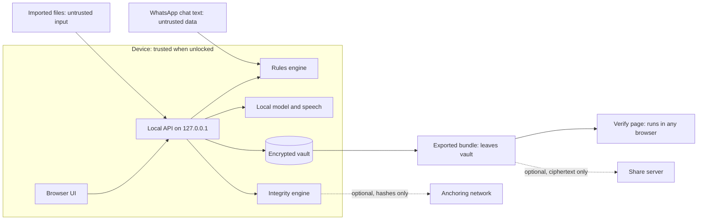

# Threat Model

This document lists what VeriDoc protects, who might attack it, where trust boundaries lie, the threats and mitigations, and the risks that remain. It must be updated whenever a new input or a new boundary is added.

Last updated: 2026-10-25
Status: Draft v1

## 1. Assets

| ID | Asset | Why it matters |
|---|---|---|
| A1 | Chats, voice notes and transcripts | Contain prices, names, bank details |
| A2 | Vault contents (terms, versions, recaps) | The record of the deal |
| A3 | Hash chain, Merkle root, receipt | The integrity of the record |
| A4 | Passphrase and recovery key | Open the vault |
| A5 | Model files and manifest | A swapped model could give wrong terms |
| A6 | Echo-code confirmations | Evidence that the other side agreed |
| A7 | Dispute packs and exports | Leave the vault; may include personal data |
| A8 | Reputation and honesty of claims | Over-claiming harms users |

## 2. Actors

| Actor | Description |
|---|---|
| Honest user | Primary user running VeriDoc |
| Counterparty | Other party; may later dispute the deal |
| Dishonest user | Wants to edit a chat or backdate a record |
| Dishonest counterparty | Wants to deny a confirmation or inject text into chat |
| Thief | Found a lost USB stick or laptop |
| Local malware | Runs on the same machine |
| Malicious file author | Supplies a crafted chat export, zip or audio file |
| Network attacker | Present only if optional anchoring or share link is on |
| Verifier | Checks a record; may receive a tampered bundle |

## 3. Trust boundaries

Boundaries: (1) imported files and chat text are untrusted; (2) the local API only accepts connections from the same machine; (3) the AI is untrusted for correctness, so it cannot write to the vault; (4) exports leave the vault unencrypted unless packaged otherwise; (5) the network is used only by the anchoring and share modules.

## 4. Threats and mitigations

STRIDE letters: S spoofing, T tampering, R repudiation, I information disclosure, D denial of service, E elevation of privilege.

| # | Threat | Actor | Type | Mitigation | Residual risk |
|---|---|---|---|---|---|
| T1 | Edit a message in an exported chat after import | Dishonest user | T | Per-item hashes, salted Merkle root, verify page names the changed message | None after import; before import, authenticity is unknowable |
| T2 | Backdate the record | Dishonest user | T | Device-clock time is labelled as such; anchoring (P1) gives independent time | Until anchored, the clock can be wrong |
| T3 | Import a fabricated chat | Dishonest user | S | Not detectable. The product says so on screen and in LIMITS. Echo-code replies add some weight but depend on the export. | Accepted and stated |
| T4 | Replace an earlier agreement version | Dishonest user | T | Version chain; later links fail | None if the verifier uses an earlier-held receipt |
| T5 | Counterparty denies sending "CONFIRM <code>" | Dishonest counterparty | R | Reply stored as a hashed leaf; code bound to recap hash | Depends on export authenticity |
| T6 | Someone other than the counterparty types the reply | Either | S | Sender check; "sender entered by user" is marked; limit stated | Cannot prove who held the phone |
| T7 | Guess the 4-character code | Either | S | 20-bit binding; code is not a secret; reply must come from the counterparty in the chat | Low entropy by design; not authentication |
| T8 | Prompt injection in chat text | Dishonest counterparty | T, E | Data fencing, schema-constrained output, grounding, human confirm, injection fixtures | Small models may still mis-extract; human confirm is the control |
| T9 | Model proposes a value not in the chat | Model error | T | Grounding check; drop and count | Rare plausible false values may pass; human confirm |
| T10 | Swapped or poisoned model file | Local malware | T | SHA-256 manifest check at startup; safe mode on mismatch | A malware with write access could also change the manifest; repo CODEOWNERS and signed releases (future) |
| T11 | Lost or stolen stick | Thief | I | AES-GCM vault, Argon2id, no plaintext on disk | Weak passphrase; guidance in S11 |
| T12 | Lost passphrase and recovery key | Honest user | D | Recovery key printed at setup, warning on S11 | Data is lost by design |
| T13 | Malicious zip (path traversal, zip bomb) | File author | T, D, E | Reject unsafe paths, size and ratio caps, stream extraction | Parser bugs; fuzz tests |
| T14 | Crafted chat text crashes parser or causes ReDoS | File author | D | Linear-time parsing, regex review, timeouts, fuzz tests | Low |
| T15 | Malicious audio file exploits decoder | File author | E | Decode with maintained libraries, run transcription in a separate process with limits, update dependencies (pip-audit) | Library vulnerabilities |
| T16 | Local web server reached from the network or another site | Network or web page | I, E | Bind to 127.0.0.1, random port, CSRF-safe design (token header, strict origin check) | Local malware can still talk to the server |
| T17 | Content in logs | Honest developer | I | Logging rule: no content or identifiers; lint check; review | Developer error |
| T18 | Secrets or real chats committed | Developer | I | `.gitignore`, gitleaks, pre-commit hook, rules in CLAUDE.md and AGENTS.md | Human error |
| T19 | Verify page tampered or replaced with one that always says UNCHANGED | Verifier risk | S | Verify page is a single small file; its own SHA-256 published in release notes; independent Python verifier; open source | The verifier must obtain the page from a trusted source |
| T20 | Hash or canonicalisation differs between Python and JavaScript | Bug | T | Shared test vectors; CI runs both | Low once vectors pass |
| T21 | Exports leak personal data | Honest user | I | Warning before export; P1 mask; selective disclosure (P1) | Mask regexes can miss data; user review via preview |
| T22 | Share link leaks the key | Network attacker | I | Key only in URL fragment, never sent to server; expiry, revoke, access log (P1) | Link forwarding by the recipient |
| T23 | Anchoring leaks information | Network attacker | I | Only a hash leaves the device; off by default | Metadata (time, address) is public |
| T24 | Over-claiming in the UI or docs | Team | R | Wording rules, review in the definition of done | Human error |
| T25 | Dependency compromise | Supply chain | T | pip-audit, lockfile with hashes, minimal dependencies | Zero-day |
| T26 | Antivirus quarantines the launcher | Environment | D | Pre-test on target laptops; recorded backup | Venue policy |
| T27 | Insert-only table modified by direct file edit | Dishonest user | T | Triggers are not the main control; the Merkle root and chain catch tampering at verification | Triggers do not stop a determined file editor |
| T28 | Clipboard exposure of suggested text | Local malware | I | Text is short and non-secret; user sends it themselves | Accepted |

## 5. Residual risks (accepted and stated)

1. A fabricated chat imported in good faith by a dishonest user cannot be detected.
2. Device-clock time can be wrong until anchored.
3. The echo code binds a reply to a recap; it does not identify the replier.
4. Small models can mis-extract; every term needs human confirmation.
5. A user with a weak passphrase is exposed if the stick is stolen.
6. Local malware with full control can read the vault while it is unlocked.

## 6. Review rule

When a feature adds a new input (file type, paste box, network call) or a new boundary (export, share, anchoring), add or update a threat row in the same change. This is part of the definition of done.
