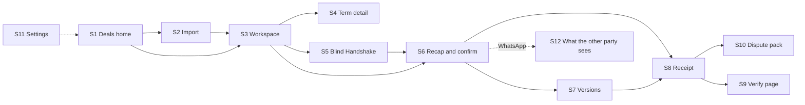

# UX Flows

This document describes screens S1 to S12 from `docs/source/veridoc-wireframes.html`: purpose, elements, states, empty and error states, and copy rules. The wireframes are low fidelity (desktop layout at 1120 px, 8 px spacing grid, one accent colour). Visual design and final copy are decided by Area 4. The wireframe file may still say "Vachan", the old working name; read it as VeriDoc.

Last updated: 2026-10-25
Status: Draft v1

## 1. S0 overview and flow

S0 in the wireframes is an overview and legend, not a screen.

Status labels (symbol and word, never colour alone): ✓ Clear · ! Ambiguous · ○ Missing · ⚠ Conflict. Build priority tags: MVP, P1, Roadmap.

## 2. Global rules

| Rule | Detail |
|---|---|
| Header | Product name, breadcrumbs, "Offline mode" indicator, lock-vault action |
| One primary action | Each screen has one primary button |
| Status wording | Symbol plus word everywhere |
| Language | English and Hindi UI strings; Kannada after native review (P1) |
| Type | Body at least 16 px; scalable to 200% |
| Keyboard | All actions reachable; visible focus; no keyboard trap |
| Disclaimers | "Drafting aid, not legal advice" on S6, S10, About. The authenticity limit on S8 and S9. |
| Words to use | tamper-evident, court-ready evidence package, record |
| Words to avoid | proof of authenticity, certainty claims, legal advice (except in "not legal advice"), fake detection |
| Errors | Say what happened, what is safe, and what to do next. No codes alone. |
| Loading | Show progress for transcription and model loading with a plain label |
| Mock data | Area 4 builds every screen against mock data shaped like `packages/contracts` |

## 3. Screens

### S1 Deals home (MVP)

**Purpose.** List every deal with how provable it is and what needs attention next.

**Elements.**
1. New deal button (primary), opens S2.
2. Search by deal name and participant (local only).
3. Filter tabs: All, Needs attention, Awaiting confirmation, Confirmed.
4. Deal rows: names and deal type; Evidence strength bar and number; open gaps (or "⚠ 1 conflict · 4 gaps"); next date; status (Awaiting Meena, Confirmed v2, Draft, Awaiting reply); Open.
5. Offline mode indicator and Lock vault.

**States.** Normal; filtered; search with no result.

**Empty.** "No deals yet. Start one by importing a chat." with the New deal button and "Try a sample deal".

**Error.** Vault locked: show the unlock prompt (S11 passphrase). Database check failed: show the self-check message and offer safe steps.

**Copy rules.** Header line "4 deals · 1 needs a reply · stored on this device". A row with a conflict is highlighted and sorted first under "Needs attention".

### S2 Import chat (MVP)

**Purpose.** Bring in a chat and check what the parser understood before analysis.

**Elements.**
1. Source tabs: WhatsApp export, Paste text, Simulator. Drop zone for `.txt` or `.zip`. Sample chats: Clean, Ambiguous, Contradictory.
2. Preview: file name, message count (text and media omitted), participants, date range, date-order assumption.
3. Which one is you (required).
4. Deal type: Supply or order and Freelance job enabled; Rent and others shown as later and disabled.
5. Privacy line: "This chat stays on this device. Nothing is uploaded." (permanent).
6. Cancel and Analyse chat (primary).

**States.** No source; parsing; preview ready; format problem banner; date order question; voice notes found (transcription starts after Analyse, with progress).

**Empty.** Drop zone with instructions for Android and iPhone export.

**Error.** Unreadable file: "We could not read this file. Choose the exported .txt or .zip." Partial parse: banner with the first unparsed lines. Too large: size message. No deal is created until Analyse.

**Copy rules.** Say "export" and "chat" in plain words. Never say "upload" except in the privacy line.

### S3 Deal workspace (MVP)

**Purpose.** Main screen: chat on the left, live analysis on the right, one suggested message.

**Elements.**
1. Chat panel: messages with numbers (#1, #2) as anchors, sender, time, highlights for terms (paired with a label), voice notes with play and transcript, input box (Send adds a simulator message), Recap button in the header.
2. Evidence strength: bar and number out of 100; counts "Present x of n · Clear x of n · Acknowledged by both x of n"; "why" opens per-term points.
3. Terms found: fixed list with value, status and source number. Missing rows are listed. Selecting a row opens S4. "Found, not confirmed" badge for unconfirmed terms.
4. Flags list under the terms, each with a plain reason.
5. Suggested next message: tone selector (Casual, Polite, Firm), editable text, "Closes: Delivery, Final payment", Edit, Use this (copies to clipboard).

**States.** Rules-only result shown first; AI refining (progress label); safe mode banner; needs-review markers; all terms clear.

**Empty.** Chat with no deal terms yet: "No terms found yet. Keep chatting or import more messages."

**Error.** Model failed: "The AI helper is unavailable. Showing rules-only results." Nothing is lost.

**Copy rules.** "Use this" copies the text for you to send in WhatsApp; the app never sends. After a reply is imported show "Score 61 to 76" style before and after.

### S4 Term detail and source (MVP)

**Purpose.** Show exactly where a term came from, why it was flagged, and let the person confirm, correct or reject it.

**Elements.**
1. Source viewer: the source message and neighbours, value highlighted. For voice: transcript segment, confidence, Play the moment.
2. Term value, status, and the reason in plain language.
3. Set the exact value (date picker or amount field).
4. Reject term and Confirm value (primary).
5. Note: "Every extracted term needs a person to confirm it. Nothing is added to the record automatically."

**States.** Clear; Ambiguous; Conflict (both values listed, choose one); Needs review (rules and AI values both shown); low-confidence voice.

**Error.** Invalid value entered: inline message next to the field.

**Copy rules.** Corrections are logged; say so ("This change is logged").

### S5 Blind Handshake (MVP, lite)

**Purpose.** Each side answers the same key questions privately; answers are sealed, then revealed side by side.

**Elements.**
1. Progress: 1 Ask, 2 Sealed, 3 Reveal.
2. Mode label: Handover mode or Reply mode, with its limit in words.
3. Question form (3 to 4 questions) for the current party; answers hidden after sealing.
4. Seal records: party, Sealed, time, short hash.
5. Reveal table: question, answer of each party, result (✓ Match, ⚠ difference described, for example "7 days apart", "Different terms").
6. Draft message for both, and Resolve mismatches.
7. Skip (goes to plain recap).

**States.** Not started; party 1 asking; party 1 sealed; party 2 asking; both sealed; revealed with matches only; revealed with mismatches; resolved; skipped.

**Error.** Closing the page between parties keeps sealed answers; unsealed answers are discarded.

**Copy rules.** "Neither side could see the other's answers before sealing" is shown only for Handover mode. Reply mode says "The other side's answers were visible to you in WhatsApp before sealing."

### S6 Recap and confirm (MVP)

**Purpose.** Show a short plain-language recap from confirmed terms; the other party confirms by replying with an echo code.

**Elements.**
1. Recap with language tabs English, Hindi, Kannada (Kannada disabled with a P1 tag). Each line has a source link.
2. Disclaimer: "Drafting aid, not legal advice. Please read each line before confirming."
3. Confirmations: you (Confirmed with time) and the other party (Waiting, Confirmed or Not confirmed).
4. Echo code (for example 7F3K) with an explanation: "Meena replies CONFIRM 7F3K in WhatsApp. The code comes from the recap's fingerprint, so it only matches this exact text."
5. Copy WhatsApp message.
6. Paste her reply box and Check reply.
7. Versions link.

**States.** Draft (terms excluded because unconfirmed are listed); sent; confirmed; not confirmed with the reason ("code does not match this recap", "this code is for an older version", "sender is not the other party"); stale code after an edit.

**Error.** Reply has no code: "We could not find a CONFIRM code in this reply."

**Copy rules.** The WhatsApp message stays friendly and short, with no legal terms.

### S7 Versions and changes (MVP, lite)

**Purpose.** A changed term becomes a clear difference between versions that both sides confirm, not a new contract.

**Elements.**
1. History: Version n (Current), earlier versions with date, change summary and who confirmed.
2. Diff table: Term, Version a, Version b, Change (No change, Changed, Added, Removed). Changed rows emphasised; unchanged rows stay visible.
3. Reason linked to a chat message.
4. Share change (copies a message with the new recap) and Confirm version n.

**States.** One version only (no diff yet); changed; awaiting confirmation; confirmed.

**Copy rules.** "Older versions are never edited, only superseded."

### S8 Receipt (MVP)

**Purpose.** The tamper-evident record: chain, commitment, timestamp, export.

**Elements.**
1. Chain of records: Chat import, Agreement v1, Agreement v2, Confirmed (or Pending), each with a short hash and time.
2. Commitment: root hash, method (SHA-256, Merkle tree, salted), messages covered, recorded at (device clock).
3. Independent timestamp (P1): status "Not anchored, device clock only", Anchor now (disabled in MVP).
4. Export receipt bundle, Create dispute pack, Open verify page.
5. Limit: "This checks that the record was not changed after it was saved. It cannot prove that the original chat export was genuine."

**States.** Not yet confirmed; confirmed; anchored (P1).

**Copy rules.** Say "tamper-evident". Say the time comes from this device's clock.

### S9 Public verify page (MVP)

**Purpose.** Standalone page, no login, no network, nothing uploaded.

**Elements.**
1. Drop zone for the receipt bundle (`.zip`).
2. Result A: ✓ UNCHANGED since recording, with each check on its own line: chain intact (n of n), Merkle root matches, timestamps consistent, independent timestamp (anchored or not).
3. Result B: ⚠ ALTERED after recording, naming the first differing item (message number, voice-note id or chain link), root mismatch, chain break.
4. The honest limit, always visible.
5. Header text "No login · no network · nothing is uploaded".

**States.** Waiting for a file; checking; unchanged; altered; unreadable bundle; unsupported spec version.

**Error.** "This file is not a VeriDoc receipt bundle." with what was expected.

**Copy rules.** Must work as a single file with all assets inline. No external fonts.

### S10 Dispute pack (MVP, basic)

**Purpose.** One export for a lawyer, a CA or the MSME Facilitation Council: a court-ready evidence package.

**Elements.**
1. Disclaimer first: "Drafting aid, not legal advice. The certificate is an unsigned draft and must be completed by the person responsible for the device."
2. Pack contents (each can be switched off): deal timeline, evidence index with hashes, agreed terms with all versions, draft certificate (electronic record), how to verify. Share only deal messages (P1).
3. Privacy mask preview (P1): original and masked sample; "Masked parts still verify against the original receipt. Money amounts and dates are never masked."
4. Estimated size and pages; Preview PDF; Export pack (primary).
5. Back to receipt.

**States.** Preview ready; exporting; exported with file location; export failed (disk full, permission).

**Copy rules.** Show the disclaimer before any export action and print it on page one. Warn that exported files are no longer encrypted.

### S11 Settings and vault (MVP, lite)

**Purpose.** Unlock the vault, recovery key, language, AI model status and timestamping.

**Elements.**
1. Vault and recovery: Passphrase (Change), Recovery key (shown once at setup; Print key). Plain warning: "If both are lost, the data cannot be opened."
2. Language: UI and recap language.
3. AI and models: Extraction model name (TBD) with "Hash verified" or "Hash mismatch"; Speech to text status; Cloud AI Off (Disabled); Safe mode Rules only (On or Off).
4. Timestamping: "Anchor receipts when online" (P1, Off by default; "Sends only a hash, never chat content").
5. About and limits: the exact wording from [LIMITS](LIMITS.md).

**Note.** The wireframe shows speech to text as "Not enabled, Roadmap". The PRD makes voice transcription an MVP feature (conflict logged in OPEN_QUESTIONS). The PRD wins.

**States.** First run (set passphrase, show recovery key); locked; unlocked; safe mode on with reason.

**Error.** Wrong passphrase: "That passphrase did not open the vault." with the remaining option to use the recovery key.

### S12 What the other party sees in WhatsApp (MVP)

**Purpose.** Show the counterparty's view. It is not an app screen; it documents the message the counterparty receives.

**Elements.**
1. The recap message: greeting, bullet lines, "If all correct, reply: CONFIRM 7F3K".
2. The counterparty's reply "CONFIRM 7F3K" in the same chat.
3. No app, link or account for the counterparty.
4. The code is tied to the text; any change to a line changes the code.

**Copy rules.** The message reads like a friendly check, not a contract. In Hindi it uses the Hindi template.

## 4. Empty and error states summary

| Situation | Message pattern |
|---|---|
| No data | What this screen will show, and the first action |
| Bad input | What is wrong, where, how to fix |
| Model unavailable | "Showing rules-only results." Nothing is lost. |
| Vault locked | Unlock prompt, no data shown |
| Self-check failure | Which check failed, what is safe, what to do |
| Export failure | The reason in words, and that no partial file was left |
